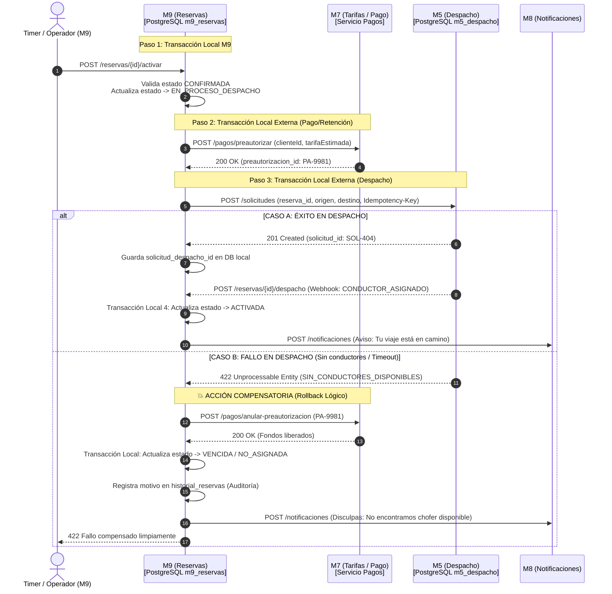

# Trabajo Práctico de Investigación: Consistencia y Persistencia en Sistemas Distribuidos
**Cátedra:** Desarrollo de Software — UTN Facultad Regional Resistencia (2026)  
**Módulo Asignado en el TPI:** Módulo 9 (M9 - Reservas de Viajes)  
**Grupo:** 8 (Equipo de 10 Integrantes)  

---

## Índice General
1. [Sección I: Investigación Conceptual Exhaustiva (Criterio 1)](#sección-i-investigación-conceptual-exhaustiva)
   - 1.1. Eje Consistencia: Patrón Saga y Transacciones Distribuidas
   - 1.2. Eje Persistencia: Base de Datos por Servicio y Propiedad de Datos
   - 1.3. Marco Teórico y Bibliografía
2. [Sección II: Relación y Aplicación con el Módulo M9 del TPI (Criterio 2)](#sección-ii-relación-y-aplicación-con-el-módulo-m9-del-tpi)
   - 2.1. Arquitectura del Ecosistema de Movilidad y el Rol de M9
   - 2.2. Aplicación de "Database per Service" en M9
   - 2.3. Aplicación del Patrón Saga en el Flujo de Activación y Despacho
   - 2.4. Resiliencia, Trazabilidad e Idempotencia
3. [Sección III: Análisis Crítico y Decisiones Técnicas (Criterio 3)](#sección-iii-análisis-crítico-y-decisiones-técnicas)
   - 3.1. Criterios de Utilización: Escenarios de Uso y No-Uso
   - 3.2. Evaluación Multidimensional de Factores (Trade-offs)
   - 3.3. Comparativa de Alternativas Técnicas
4. [Sección IV: Plan de Exposición y Distribución para 10 Integrantes](#sección-iv-plan-de-exposición-y-distribución-para-10-integrantes)
   - 4.1. Estructura de la Presentación y Cronograma
   - 4.2. Matriz de Roles, Contenido y Preguntas de Coloquio por Integrante

---

# Sección I: Investigación Conceptual Exhaustiva

## 1.1. Eje Consistencia: Patrón Saga y Transacciones Distribuidas

### 1.1.1. El problema de fondo: Por qué fallan las transacciones clásicas en la nube
En arquitecturas tradicionales monolíticas, la consistencia de los datos está garantizada por las propiedades **ACID** (Atomicidad, Consistencia, Aislamiento y Durabilidad) provistas por los motores de bases de datos relacionales (RDBMS). Toda operación compuesta se agrupa bajo un bloque transaccional:
$$\text{BEGIN TRANSACTION} \longrightarrow \text{Operación 1} \longrightarrow \text{Operación 2} \longrightarrow \text{COMMIT}$$
Si cualquiera de las operaciones intermedias falla, el motor ejecuta un `ROLLBACK` a nivel de disco y memoria, regresando los datos a su estado original sin efectos colaterales.

Sin embargo, al migrar a una arquitectura de **microservicios**, cada servicio posee su propio proceso, su propio ciclo de vida y su propia base de datos. Surge entonces el dilema del **Teorema CAP** (Eric Brewer) y el modelo **PACELC**: en presencia de particiones de red ($P$), un sistema distribuido debe optar entre Consistencia Estricta ($C$) o Disponibilidad ($A$).

Históricamente se intentó resolver esto mediante el protocolo **Two-Phase Commit (2PC / XA)** o transacciones distribuidas globales. No obstante, 2PC presenta fallas críticas en entornos modernos:
- **Bloqueo Síncrono (Blocking Protocol):** Todos los nodos deben retener bloqueos de fila/tabla hasta que el coordinador complete la fase 2, degradando drásticamente el rendimiento.
- **Punto Único de Falla (SPOF):** Si el coordinador colapsa durante la fase de confirmación, los participantes quedan en estado de incertidumbre (*in-doubt state*).
- **Incompatibilidad con servicios de terceros:** No es viable obligar a una pasarela de pagos externa (Stripe, Mercado Pago) o a un servicio de mensajería a participar de una transacción 2PC.

### 1.1.2. Definición formal del Patrón Saga
El concepto fue formalizado por **Hector Garcia-Molina y Kenneth Salem en 1987** para bases de datos de larga duración (*Long-Lived Transactions*) y posteriormente adaptado a microservicios por **Chris Richardson** (*Microservices Patterns*).

Una **Saga** es una secuencia de transacciones locales ($T_1, T_2, \dots, T_n$) ejecutadas en diferentes microservicios. Cada transacción local actualiza la base de datos de su servicio y publica un mensaje o evento que desencadena la siguiente transacción. Si una transacción local $T_k$ fracasa (por validación de negocio, falta de stock o caída técnica), la Saga garantiza la consistencia ejecutando una serie de **transacciones compensatorias** ($C_{k-1}, \dots, C_1$) en orden inverso, neutralizando los cambios producidos por las transacciones ya confirmadas.

$$\text{Flujo exitoso: } T_1 \to T_2 \to T_3 \to T_n$$
$$\text{Flujo con fallo en } T_3: T_1 \to T_2 \to T_3 \text{ [FALLA]} \to C_2 \to C_1$$

### 1.1.3. Clasificación de transacciones dentro de una Saga
Para diseñar una Saga correcta, las transacciones se clasifican formalmente en tres tipos:
1. **Transacciones Compensables ($T_c$):** Transacciones que pueden ser deshechas mediante una transacción compensatoria explícita (ej.: retener saldo $\leftrightarrow$ devolver saldo).
2. **Transacción Pivotante ($T_p$):** El punto de no retorno de la Saga. Si $T_p$ se confirma exitosamente, la Saga está garantizada a completarse. Si $T_p$ falla, la Saga debe abortar y compensar todas las transacciones previas.
3. **Transacciones Reintentables ($T_r$):** Transacciones que ocurren luego de la transacción pivotante y que tienen garantía de éxito eventual mediante reintentos con respaldo exponencial e idempotencia (ej.: enviar correo o generar comprobante).

### 1.1.4. Variantes de Coordinación: Coreografía vs. Orquestación

| Criterio | Saga Coreografiada (Choreography) | Saga Orquestada (Orchestration) |
| :--- | :--- | :--- |
| **Mecanismo** | Descentralizado; los servicios publican y consumen eventos de dominio reactivamente. | Centralizado; un componente ("Orquestador") invoca comandos y gestiona el flujo de estados. |
| **Acoplamiento** | Muy bajo a nivel de transporte; pero existe acoplamiento semántico indirecto entre eventos. | Los participantes desconocen la existencia de la Saga; solo exponen APIs/comandos limpios. |
| **Visibilidad del Flujo** | Difícil de rastrear y monitorear (lógica dispersa en múltiples manejadores de eventos). | Centralizada, predecible y fácil de auditar mediante una máquina de estados explícita. |
| **Riesgo Principal** | Dependencias cíclicas de eventos y complejidad al escalar a más de 4-5 participantes. | Sobrecarga de lógica en el orquestador (*God Object* si no se diseña con cuidado). |

> [!NOTE]
> ### 💡 Bajada a Tierra: ¿Qué es una Saga en el mundo real?
> Imaginate que querés comprar un combo en un local de comida rápida: hamburguesa, papas y un juguete coleccionable especial.
> En un sistema tradicional ("monolito"), el cajero solo te cobra si tiene la hamburguesa, las papas y el juguete en la mano listos para entregar.
> En microservicios, la cocina es un servicio, la freidora es otro, y el depósito de juguetes es otro.
> 1. Primero vas al mostrador y pagás el combo (se confirma tu plata).
> 2. Te entregan la hamburguesa y las papas.
> 3. Cuando van al depósito a buscar el juguete, se agotó.
> No podés "deshacer el universo" mágicamente. Lo que hace el cajero es ejecutar una **compensación**: te devuelve el dinero del juguete (o te cancela el cobro completo) y vos devolvés la bandeja. Cada uno vuelve a estar en paz. Eso es una Saga: **hacer las cosas paso a paso y saber exactamente cómo disculparse y deshacer lo hecho si el último eslabón se rompe**.

---

## 1.2. Eje Persistencia: Base de Datos por Servicio y Propiedad de Datos

### 1.2.1. El problema: El antipatrón de la Base de Datos Compartida
En muchas migraciones a microservicios se cae en la trampa del **"Monolito Distribuido"**: se separan las aplicaciones en procesos distintos, pero todos siguen atacando a las mismas tablas en un único motor de base de datos central.
Este enfoque destruye los beneficios de los microservicios:
- **Acoplamiento Férreo de Esquemas:** Si el equipo de *Conductores* cambia una columna de `INTEGER` a `VARCHAR`, o normaliza una tabla, rompe silenciosamente las consultas del servicio de *Viajes* y *Reservas*.
- **Contención y Bloqueos de Concurrencia:** Consultas pesadas de auditoría o reportes pueden degradar las transacciones operativas de despacho.
- **Imposibilidad de Elección Tecnológica (Polyglot Persistence):** No se puede elegir una base documental (MongoDB) para viajes no estructurados y una relacional (PostgreSQL) para transacciones contables.

### 1.2.2. Definición formal de "Database per Service" y "Data Ownership"
El patrón **Database per Service** (Sam Newman, *Building Microservices*) postula que cada microservicio debe poseer su propio almacén de datos persistente.
- **Propiedad Exclusiva (Data Ownership):** Ningún componente externo tiene acceso directo (SQL `SELECT`, `UPDATE`, `JOIN`) al almacenamiento del servicio. Las tablas son privadas y forman parte de la implementación interna.
- **Acceso Exclusivo por Contrato:** Toda lectura o mutación de datos debe canalizarse a través de las interfaces públicas del servicio (APIs REST/gRPC o suscripción a eventos de dominio).
- **Límites de Dominio (Bounded Contexts):** Basado en *Domain-Driven Design* (DDD) de Eric Evans, cada servicio modela sus entidades según las necesidades de su subdominio, evitando modelos de datos universales gigantes y frágiles.

```
       [ Servicio A ]               [ Servicio B ]
             │                            │
             ▼ (API Privada)              ▼ (API Privada)
     ┌───────────────┐            ┌───────────────┐
     │  DB Privada A │            │  DB Privada B │
     └───────────────┘            └───────────────┘
             ▲                            ▲
             └────── ❌ PROHIBIDO ────────┘
                  (JOIN directo SQL)
```

### 1.2.3. Mecanismos para compartir información sin romper el aislamiento
Para correlacionar información entre dominios aislados, se emplean tres patrones complementarios:
1. **Composición de API (API Composition):** Un servicio de agregación o API Gateway consulta secuencial o paralelamente a las APIs públicas de los servicios dueños y combina los DTOs en memoria.
2. **Replicación Asíncrona basada en Eventos (Event-Carried State Transfer):** Un servicio publica eventos ante cambios de estado (`ClienteRegistradoEvent`, con id y nombre). Los servicios interesados almacenan una copia local de sólo lectura con los atributos mínimos que necesitan.
3. **CQRS (Command Query Responsibility Segregation):** Separación de modelos de escritura (fuente de verdad normalizada en cada servicio) y modelos de lectura (vistas materializadas optimizadas para consultas complejas).

> [!NOTE]
> ### 💡 Bajada a Tierra: ¿Qué es la Propiedad de Datos?
> Pensá en los vecinos de un edificio. Cada uno tiene su propio departamento y su propia alacena.
> Si tu vecino necesita un paquete de azúcar, **no entra con una llave maestra a tu casa a revolver tus cajones mientras estás durmiendo** (eso sería hacer un `SELECT *` directo a la base de datos ajena).
> Tu vecino te toca el timbre en la puerta (la API REST) y te pide: *"¿Me prestás un paquete de azúcar?"*. Vos vas a tu cocina, buscás el azúcar y se lo entregás en la mano. 
> Tu vecino no tiene ni idea de si guardás el azúcar en un frasco de vidrio, en una caja de cartón o si cambiaste de lugar los estantes ayer (cambio de esquema interno). La puerta de entrada es el único contrato que importa.

---

## 1.3. Marco Teórico y Bibliografía de Referencia
- **Richardson, Chris (2018):** *Microservices Patterns: With examples in Java*. Manning Publications. (Capítulo 4: Gestión de transacciones con Sagas; Capítulo 2: Descomposición y persistencia por servicio).
- **Newman, Sam (2021):** *Building Microservices: Designing Fine-Grained Systems (2nd Edition)*. O'Reilly Media. (Capítulo 4: Modelado de integración y patrones de base de datos).
- **Garcia-Molina, Hector; Salem, Kenneth (1987):** *Sagas*. ACM SIGMOD Record, 16(3), 249-259.
- **Evans, Eric (2003):** *Domain-Driven Design: Tackling Complexity in the Heart of Software*. Addison-Wesley.
- **Fowler, Martin:** *Saga Pattern & Database per Service Pattern* (martinfowler.com).

---

# Sección II: Relación y Aplicación con el Módulo M9 del TPI

## 2.1. Arquitectura del Ecosistema de Movilidad y el Rol de M9
La plataforma de movilidad urbana distribuida del TPI se compone de 9 módulos interconectados mediante contratos OpenAPI 3.0:
- **M2 (Clientes):** Estado de cuenta, identidad y bloqueo de pasajeros.
- **M3 (Conductores):** Padrón, documentación y habilitación de choferes.
- **M4 (Ubicación y Cobertura):** Validación geoespacial, cálculo de distancias y rutas.
- **M5 (Solicitud y Despacho):** Asignación y matching en tiempo real entre pasajeros y conductores.
- **M6 (Viajes):** Ejecución, seguimiento por odómetro/GPS y finalización del viaje.
- **M7 (Tarifas):** Estimación de precios según distancia, tiempo y horario.
- **M8 (Notificaciones):** Envíos multicanal (Push, SMS, Email).
- **M9 (Reservas de Viajes):** Gestión del ciclo de vida de viajes programados con antelación mínima obligatoria (2 horas).

## 2.2. Aplicación de "Database per Service" en M9

### 2.2.1. Aislamiento estricto de la base de datos de M9
El Módulo 9 dispone de su propio contenedor PostgreSQL (`m9_reservas`), ejecutado en un puerto y volumen aislado, cuyo esquema (`01_init_schema.sql`) define tres tablas exclusivas:
1. `reservas`: Almacena el estado del viaje programado (`id`, `cliente_id`, `origen`, `destino`, `fecha_hora`, `tarifa_estimada`, `estado`, `solicitud_despacho_id`).
2. `historial_reservas`: Registro inmutable de auditoría para cada transición de estado (`RF-9.12`).
3. `idempotencia`: Garantía de deduplicación de solicitudes HTTP (`RF-9.10`).

### 2.2.2. Prohibición de acoplamiento relacional directo
M9 **no posee claves foráneas (`FOREIGN KEY`) hacia tablas de otros módulos**, ni realiza conexiones cruzadas:
- No existe un `REFERENCES m2_clientes(id)`. El campo `cliente_id` es un escalar (UUID).
- Si M9 necesita validar si el cliente puede reservar, no ejecuta un `SELECT estado FROM m2_clientes WHERE id = ...`. En su lugar, consume el cliente HTTP tipado `M2Client.verificarEstadoCuenta(clienteId)` contra el endpoint de M2.
- Si M2 cambia sus índices, renombra campos internos o cambia su motor a CockroachDB, **M9 no se ve afectado en absoluto**.

```typescript
// Implementación real en M9 (src/services/reservationService.ts)
// Validación de dominio mediante contrato REST, preservando la propiedad de datos:
const estadoCuenta = await M2Client.verificarEstadoCuenta(data.clienteId, requestId);
if (estadoCuenta.estado === 'BLOQUEADO') {
  throw new AppError({
    status: 422,
    title: 'Cliente bloqueado',
    detail: `El cliente ${data.clienteId} se encuentra bloqueado para realizar reservas.`
  });
}
```

---

## 2.3. Aplicación del Patrón Saga en el Flujo de Activación y Despacho

### 2.3.1. El caso de uso crítico: Activación de Reserva
El proceso más crítico de M9 ocurre cuando una reserva programada alcanza su ventana temporal de activación (entre 15 y 30 minutos antes de la hora fijada). En ese instante, M9 debe orquestar una operación multi-servicio:



### 2.3.2. Anatomía de la compensación en M9
- **Transacción local previa ($T_1$):** Actualizar estado en `reservas` a `EN_PROCESO_DESPACHO`.
- **Transacción compensable ($T_2$):** Retención monetaria en el subsistema financiero.
- **Transacción pivotante ($T_3$):** Aceptación y despacho por parte de M5.
- **Acción Compensatoria ($C_2$):** Liberación de la pre-autorización financiera.
- **Acción Compensatoria ($C_1$):** Transición de estado en M9 a `VENCIDA` con inserción del evento en `historial_reservas`.

## 2.4. Resiliencia, Trazabilidad e Idempotencia
La Saga se blinda mediante mecanismos técnicos ya implementados en el código de M9:
- **Idempotencia Estricta (`Idempotency-Key`):** M9 reenvía la misma clave (`reserva.claveIdempotencia`) hacia M5 (`M5Client.ts`). Si hay una desconexión de red y M9 reintenta, M5 no crea una solicitud duplicada.
- **Webhook Callback Idempotente (`POST /reservas/:id/despacho`):** Si M5 notifica dos veces la asignación del conductor, el método `ActivationService.procesarWebhookDespacho` detecta que la reserva ya está en estado `ACTIVADA` y retorna HTTP 200 sin duplicar historial.
- **Trazabilidad Distribuida (`X-Request-Id`):** Cada llamada inter-servicio propaga el identificador UUID v4 en las cabeceras HTTP, permitiendo reconstruir la secuencia completa de la Saga en los logs.

---

# Sección III: Análisis Crítico y Decisiones Técnicas

## 3.1. Criterios de Utilización: Escenarios de Uso y No-Uso

### 3.1.1. Patrón Saga
- **Cuándo SÍ utilizarlo:**
  - Operaciones de negocio que abarcan múltiples microservicios independientes donde no es aceptable el bloqueo de recursos.
  - Procesos asíncronos o de larga duración (*Long Running Actions*), como la reserva de un viaje con antelación y su posterior asignación.
  - Integración con APIs de terceros (pagos, envíos de notificaciones WhatsApp/SMS) donde no se tiene control de la base de datos de destino.
- **Cuándo NO utilizarlo:**
  - Operaciones confinadas dentro del límite de un mismo microservicio (dentro de M9 basta con una transacción SQL `BEGIN/COMMIT`).
  - Escenarios donde se requiera **Consistencia Inmediata e Inflexible** (ej.: sistemas bursátiles o transferencias bancarias directas de alta frecuencia donde el estado intermedio no puede ser visible).
  - Cuando la lógica de compensación sea físicamente imposible (ej.: una acción de negocio que ya detonó un efecto irreversible en el mundo físico, como la impresión de un ticket o el disparo de un mensaje masivo que no puede "des-enviarse").

### 3.1.2. Base de Datos por Servicio
- **Cuándo SÍ utilizarlo:**
  - Equipos de desarrollo independientes que necesitan desplegar y evolucionar sus módulos sin coordinar migraciones de esquemas con otros equipos.
  - Sistemas con requisitos heterogéneos de persistencia (políglota: series temporales para telemetría en M6, geoespacial PostGIS en M4, relacional estricto en M9).
  - Sistemas que requieren aislamiento de fallas: una saturación de consultas en reportes de conductores no debe tirar abajo la disponibilidad de reservas.
- **Cuándo NO utilizarlo:**
  - Aplicaciones monolíticas pequeñas o MVPs donde el costo de infraestructura y la complejidad superan con creces los beneficios de escala.
  - Casos donde la mayor parte de las consultas de negocio requieran `JOINs` masivos en tiempo real entre todas las entidades del sistema y no se disponga de infraestructura de streaming (Kafka/Debezium) o CQRS.

---

## 3.2. Evaluación Multidimensional de Factores (Trade-offs)

```
        ▲ Escalabilidad / Autonomía
        │                                  ★ (M9: Saga + DB por Servicio)
        │
        │             ◆ (DB Compartida)
        │
        │   ● (Monolito ACID)
        └────────────────────────────────────────► Complejidad Técnica / Costo
```

1. **Complejidad Arquitectónica y Cognitiva:**  
   La introducción de Sagas traslada la complejidad desde el motor de base de datos hacia el código de la aplicación. Los desarrolladores deben programar explícitamente las transacciones compensatorias y manejar la **consistencia eventual** (la reserva pasa por estados temporales como `EN_PROCESO_DESPACHO` antes de confirmarse o cancelarse).
2. **Costos Operativos e Infraestructura:**  
   Tener una base de datos por servicio multiplica la cantidad de instancias de bases de datos a monitorear, respaldar y securizar (en Docker Compose: un contenedor PostgreSQL para M9, otro para M5, etc.). No obstante, reduce los costos de escalado al permitir escalar vertical u horizontalmente solo el servicio cuello de botella.
3. **Rendimiento y Latencia:**  
   Al eliminar los bloqueos distribuidos de 2PC, el rendimiento general del sistema (*throughput*) aumenta drásticamente. Sin embargo, la latencia de una operación individual aumenta, ya que requiere múltiples saltos de red HTTP/gRPC entre servicios.
4. **Mantenibilidad y Blast Radius (Radio de Explosión de Fallas):**  
   Si la base de datos de Despacho (M5) colapsa, M9 sigue en pie: los usuarios pueden continuar listando sus reservas anteriores o creando reservas futuras. El fallo queda encapsulado y no genera un colapso en cascada de toda la plataforma.

---

## 3.3. Comparativa de Alternativas Técnicas

| Factor | Monolito (ACID tradicional) | Two-Phase Commit (2PC) | Saga Orquestada (Propuesta M9) |
| :--- | :--- | :--- | :--- |
| **Garantía de Consistencia** | Inmediata (Strict Consistency) | Inmediata (Distributed ACID) | Eventual (Eventual Consistency) |
| **Escalabilidad** | Limitada a un solo nodo de BD | Muy baja (bloqueos acumulativos) | Muy alta (desacoplada) |
| **Tolerancia a Fallos** | Todo o nada en una BD | Crítica (vulnerable a caída del coordinador) | Alta (aislamiento y compensación) |
| **Resiliencia ante Terceros**| Nula | Inviable | Nativa (soporta APIs REST/Webhooks) |

---

# Sección IV: Plan de Exposición y Distribución para 10 Integrantes

Para garantizar una evaluación sobresaliente en el **Criterio 5 (Coloquio y defensa técnica - 30 puntos)**, donde la cátedra evalúa el dominio individual y la participación de todo el equipo, se estructura una presentación de **20 minutos totales** (aprox. 2 minutos netos por integrante) con roles complementarios y preguntas técnicas preparadas.

```
┌────────────────────────────────────────────────────────────────────────────────────────┐
│                                 CRONOGRAMA DE EXPOSICIÓN (20 min)                      │
├─────────────────┬───────────────────┬───────────────────┬──────────────────────────────┤
│ Bloque 1: Intro │ Bloque 2: Persist │ Bloque 3: Consist │ Bloque 4: Aplicación y Demo  │
│ Integrantes 1-2 │ Integrantes 3-4   │ Integrantes 5-6   │ Integrantes 7-8-9-10         │
└─────────────────┴───────────────────┴───────────────────┴──────────────────────────────┘
```

---

### 4.2. Matriz de Roles, Contenido y Preguntas de Coloquio por Integrante

#### Integrante 1 — Introducción, Problemática Distribuida y Contexto del TPI
- **Rol:** Apertura y contextualización arquitectónica.
- **Puntos a exponer:**
  - Presentación del Grupo 8 y del Módulo 9 (Reservas de Viajes).
  - De qué se trata la arquitectura distribuida del TPI (9 microservicios autónomos).
  - El gran desafío: al fragmentar el sistema, se rompen las transacciones ACID centralizadas y la base de datos única. Introducción a los dos temas asignados: *Consistencia (Saga)* y *Persistencia (Base de Datos por Servicio)*.
- **Bajada a tierra:** La comparación entre una orquesta sinfónica donde cada músico tiene su partitura versus un director autoritario que intenta tocar todos los instrumentos a la vez.
- **Posible pregunta del tribunal:** *¿Por qué en el TPI no pudimos simplemente usar una única base de datos PostgreSQL compartida por todos los módulos?*
- **Respuesta recomendada:** *Porque generaría un acoplamiento crítico de esquemas; cualquier cambio en la estructura de una tabla rompería a los demás grupos, anularía la autonomía de despliegue y crearía un punto único de falla para toda la plataforma.*

---

#### Integrante 2 — Marco Conceptual: Patrón Database per Service y Data Ownership
- **Rol:** Fundamento teórico de persistencia.
- **Puntos a exponer:**
  - Definición formal del patrón *Database per Service*.
  - Concepto de *Data Ownership*: las tablas son privadas, la única interfaz son los contratos públicos (APIs/Eventos).
  - Riesgos del antipatrón de Base de Datos Compartida (*Shared Database*) y el "Monolito Distribuido".
- **Bajada a tierra:** La analogía de los vecinos del edificio: para pedir sal no entrás con ganzúa a revisar los cajones ajenos; tocás el timbre en la puerta.
- **Posible pregunta del tribunal:** *Si un servicio necesita datos de otro con mucha frecuencia, ¿no es ineficiente consultar por API en lugar de hacer un JOIN por SQL?*
- **Respuesta recomendada:** *Tiene una penalización en latencia de red, pero preserva el encapsulamiento. Si la frecuencia es crítica, se utilizan patrones de optimización como Event-Carried State Transfer o CQRS con réplicas locales de solo lectura, sin violar la propiedad de los datos.*

---

#### Integrante 3 — Aplicación de Persistencia Aislada en el Módulo M9
- **Rol:** Arquitectura técnica de datos de M9.
- **Puntos a exponer:**
  - Cómo está estructurada la persistencia en M9: base de datos propia PostgreSQL `m9_reservas` en Docker.
  - El esquema de tablas: `reservas`, `historial_reservas` (auditoría no destructiva) e `idempotencia`.
  - Ausencia deliberada de foreign keys directas hacia M2 (Clientes) o M3 (Conductores); solo se almacenan UUIDs de referencia.
- **Bajada a tierra:** M9 solo anota el "número de DNI" del cliente en su libreta de reservas, no guarda la foto, la dirección ni la tarjeta del cliente dentro de su base.
- **Posible pregunta del tribunal:** *¿Cómo garantizan la integridad referencial si un cliente es eliminado en M2 pero M9 tiene reservas asociadas?*
- **Respuesta recomendada:** *En microservicios, la integridad referencial física se sustituye por integridad lógica de negocio. M2 no borra físicamente clientes (soft delete o eventos de baja), y M9 valida el estado del cliente a través de M2Client antes de cualquier acción crítica.*

---

#### Integrante 4 — Demostración de Resiliencia ante Cambios de Esquema
- **Rol:** Prueba de desacoplamiento de persistencia.
- **Puntos a exponer:**
  - Escenario práctico: ¿Qué ocurre si M2 o M3 deciden renombrar campos en su base interna o migrar a MongoDB?
  - Demostración de cómo M9 se aísla gracias a la capa de abstracción de clientes HTTP (`M2Client.ts`) y a los DTOs tipados en TypeScript.
  - El rol de OpenAPI 3.0 como contrato inmutable entre servicios.
- **Bajada a tierra:** Si el restaurante cambia de cocinero o reordena los estantes de su depósito, el menú que le entregan al cliente (el contrato de la API) sigue siendo exactamente el mismo.
- **Posible pregunta del tribunal:** *¿Qué pasa si el otro servicio cambia un campo que rompe el contrato OpenAPI?*
- **Respuesta recomendada:** *Para eso se aplican contratos versionados (ej. `/v1` y `/v2`) y pruebas de contrato con herramientas como Pact o esquemas compartidos, garantizando compatibilidad hacia atrás.*

---

#### Integrante 5 — Marco Conceptual: Patrón Saga y Transacciones Distribuidas
- **Rol:** Fundamento teórico de consistencia.
- **Puntos a exponer:**
  - Qué es una Saga: secuencia de transacciones locales coordinadas.
  - Por qué falla el protocolo Two-Phase Commit (2PC) en la nube: bloqueos de concurrencia y punto único de falla.
  - Los 3 tipos de transacciones en una Saga: Compensables, Pivotantes y Reintentables.
- **Bajada a tierra:** La analogía de comprar las vacaciones por separado (hotel, vuelo y auto) y tener que llamar a cancelar si el auto se agota.
- **Posible pregunta del tribunal:** *¿Una Saga garantiza aislamiento (la 'I' de ACID)?*
- **Respuesta recomendada:** *No. La falta de aislamiento es la mayor limitación de una Saga; los cambios intermedios son visibles para otros procesos antes de completarse. Para mitigar esto se utilizan estados intermedios explícitos como 'PENDIENTE' o 'EN_DESPACHO'.*

---

#### Integrante 6 — Variantes de Saga: Orquestación vs. Coreografía y Elección en M9
- **Rol:** Análisis de diseño del flujo distribuido.
- **Puntos a exponer:**
  - Diferencias técnicas entre Saga Orquestada y Saga Coreografiada.
  - Ventajas y desventajas de cada enfoque (visibilidad centralizada vs. bajo acoplamiento).
  - Justificación de por qué en M9 se eligió un enfoque de **Orquestación**: M9 es el dueño del ciclo de vida de la reserva y necesita auditar paso a paso cada estado.
- **Bajada a tierra:** Orquestación es una obra de teatro con un director que le dice a cada actor cuándo entrar a escena; Coreografía es una danza improvisada donde cada uno reacciona a los pasos del compañero.
- **Posible pregunta del tribunal:** *¿El orquestador no se convierte en un cuello de botella o punto único de falla?*
- **Respuesta recomendada:** *Si el orquestador guarda su estado en base de datos de manera idempotente (como hace M9 en PostgreSQL), cualquier réplica del servicio puede retomar la ejecución de la Saga ante una caída sin perder la consistencia.*

---

#### Integrante 7 — Flujo de la Saga en M9: Creación, Activación y Despacho
- **Rol:** Explicación del circuito de negocio en código.
- **Puntos a exponer:**
  - El ciclo de vida de una reserva en M9: `CONFIRMADA` $\to$ `EN_DESPACHO` $\to$ `ACTIVADA`.
  - La interacción de M9 con M5 (Solicitud y Despacho) y el servicio de cobro/tarifas ficticio.
  - Qué constituye la transacción pivotante: la aceptación formal del viaje y la asignación del chofer en M5.
- **Bajada a tierra:** El momento exacto en el que el chofer dice "acepto el viaje": hasta ese segundo todo era cancelable; a partir de ahí, el viaje ya está en marcha.
- **Posible pregunta del tribunal:** *¿Por qué M9 no asigna el chofer directamente en lugar de delegarlo en M5?*
- **Respuesta recomendada:** *Por el principio de Responsabilidad Única y separación de dominios de DDD: M9 solo entiende de reservas anticipadas y agendas; la optimización de flotas en tiempo real, radios de cercanía y matching es competencia exclusiva de M5.*

---

#### Integrante 8 — Manejo de Fallas y Acciones Compensatorias (Rollback Lógico)
- **Rol:** El núcleo del problema de consistencia ante errores.
- **Puntos a exponer:**
  - El escenario de error forzado: ¿Qué ocurre cuando M5 no encuentra conductor o se agota el tiempo de espera?
  - Demostración de las transacciones compensatorias ejecutadas por M9:
    1. Anulación de la retención de pago.
    2. Transición local del estado a `VENCIDA` o `CANCELADA_SIN_CONDUCTOR`.
    3. Notificación al pasajero vía M8.
    4. Grabación no destructiva del incidente en `historial_reservas`.
- **Bajada a tierra:** Si el delivery llega a tu casa con la pizza quemada, no pueden "des-quemar" la pizza: te devuelven el dinero y te dan un cupón de disculpas.
- **Posible pregunta del tribunal:** *¿Qué pasa si la acción compensatoria también falla (ej. la API de pagos no responde al pedir la anulación)?*
- **Respuesta recomendada:** *Se aplican reintentos automáticos con retroceso exponencial (Exponential Backoff), colas de mensajes no entregados (Dead Letter Queues) y, en última instancia, alertas a un panel de operadores para resolución manual conciliatoria.*

---

#### Integrante 9 — Resiliencia en la Práctica: Idempotencia y Trazabilidad
- **Rol:** Robustez técnica de la implementación en M9.
- **Puntos a exponer:**
  - Por qué la idempotencia es obligatoria en una Saga: si un reintento se ejecuta dos veces por corte de red, no se debe duplicar el cobro ni el despacho.
  - Cómo implementa M9 la cabecera `Idempotency-Key` en la tabla `idempotencia` y en las llamadas hacia M5.
  - La propagación del encabezado `X-Request-Id` a lo largo de toda la cadena de microservicios para trazabilidad distribuida de logs.
- **Bajada a tierra:** El botón del ascensor: por más que lo aprietes 10 veces desesperado, el ascensor viene una sola vez. Eso es idempotencia.
- **Posible pregunta del tribunal:** *¿Cómo sabe M9 si un webhook de M5 es una repetición o una actualización válida?*
- **Respuesta recomendada:** *Comprobando el estado actual de la reserva en base de datos: si ya está en estado 'ACTIVADA', se responde HTTP 200 inmediatamente reconociendo el mensaje sin volver a disparar los efectos secundarios.*

---

#### Integrante 10 — Conclusiones, Matriz de Trade-offs y Cierre
- **Rol:** Síntesis crítica y defensa de las decisiones de diseño.
- **Puntos a exponer:**
  - Resumen de la matriz de decisión: cuándo adoptar Saga y Database per Service (sistemas desacoplados, escalables y con alta tolerancia a fallas) y cuándo evitarlo (monolitos simples o consistencia inmediata pura).
  - Balance del trabajo práctico: cómo la combinación de ambos patrones permitió que el Módulo 9 sea robusto, autónomo y tolerante a fallas en el ecosistema del TPI.
  - Agradecimiento y apertura formal a las preguntas de la cátedra.
- **Bajada a tierra:** No hay arquitecturas perfectas, sino elecciones de compromiso: cambiamos la simplicidad de una base única por la resiliencia y escalabilidad de un sistema que no se cae cuando un módulo tiene problemas.
- **Posible pregunta del tribunal:** *Si tuvieran que rediseñar el sistema desde cero para millones de usuarios, ¿mantendrían llamadas HTTP síncronas para la Saga o qué cambiarían?*
- **Respuesta recomendada:** *Migraríamos hacia un bus de eventos asíncrono con brokers distribuidos como Apache Kafka o RabbitMQ utilizando el patrón Outbox transaccional, eliminando el acoplamiento temporal de HTTP.*

---

### 4.3. Recomendaciones Finales para el Coloquio
1. **Transiciones fluidas:** Cada integrante debe dar el pie al siguiente (ej.: *"Ahora mi compañero [Nombre] va a demostrar cómo se refleja esta persistencia en el código del Módulo 9"*).
2. **Uso de la terminología dual:** Usar primero el término técnico formal (*Transacción compensatoria*, *Idempotencia*, *Bounded Context*) y rematar con la analogía cotidiana (*"es decir, desarmar el camino andado si el chofer no aparece"*). Esto demuestra ante la cátedra no solo que memorizaron el concepto, sino que **lo entendieron profundamente**.
3. **Evidencias técnicas a mano:** Tener abiertos en la pantalla de demostración:
   - El archivo `01_init_schema.sql` y `docker-compose.yml` (para persistencia aislada).
   - El archivo `src/services/activationService.ts` (para la orquestación y compensación de la Saga).
   - Los tests de integración en `tests/integration/activationAndWebhook.test.ts` pasando en verde.
