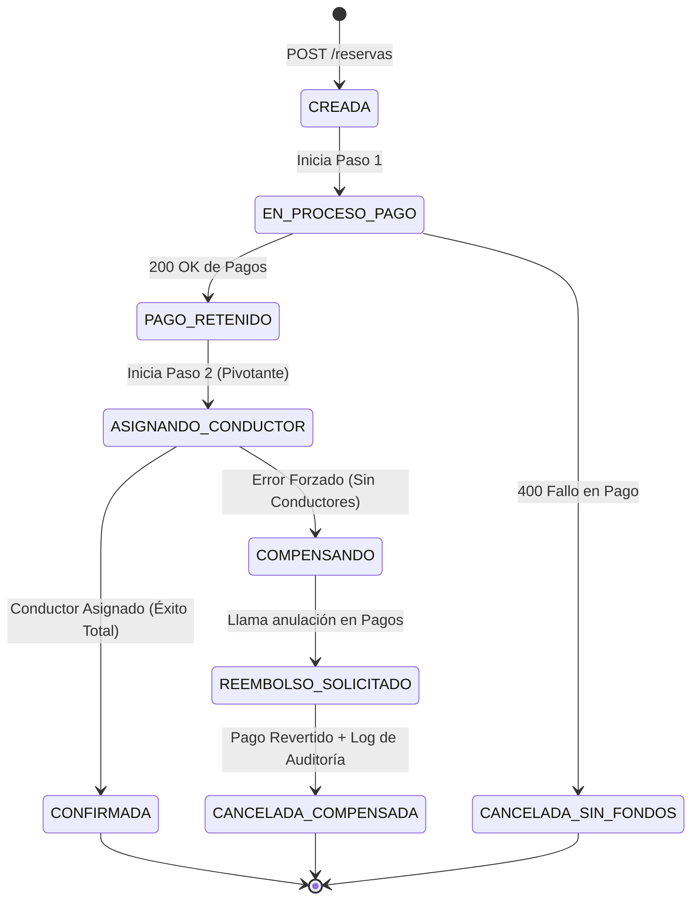

# Trabajo Práctico de Investigación — Soporte Teórico y Técnico
## Consistencia y Persistencia Avanzada en Sistemas Distribuidos
### Temas 11 y 12: Patrón Saga y Base de Datos por Servicio
**Cátedra:** Desarrollo de Software — UTN Facultad Regional Resistencia (2026)  
**Grupo:** Grupo 8 (Módulo M9 - Reservas / Movilidad Urbana)  

---

## Introducción
El presente informe profundiza en los fundamentos teóricos avanzados, criterios de resiliencia y pautas técnicas indispensables para dar soporte tanto al análisis conceptual como a la implementación práctica de los **Temas 11 (Saga y Transacciones Distribuidas)** y **12 (Base de Datos por Servicio y Propiedad de Datos)**.

El contenido se articula en dos dimensiones complementarias:
1. **Fundamentación Teórica y Análisis de Resiliencia:** Formalización matemática de consistencia (CAP/PACELC/BASE), resolución de anomalías de aislamiento en Sagas, prevención del *Dual-Write* (Transactional Outbox) y estrategias de consulta desacoplada (CQRS).
2. **Guía de Arquitectura y Patrones para la Implementación Práctica:** Lineamientos directos de diseño, máquinas de estado, inyección de fallos controlados y pruebas de aislamiento de esquemas orientados al desarrollo de la solución funcional y su defensa en el coloquio.

---

# Eje I: Fundamentos Teóricos y Patrones de Resiliencia

## 1. Fundamentos Teóricos Formales: CAP, PACELC y el Modelo BASE

### 1.1. Teorema CAP y Demostración de Gilbert-Lynch
En el año 2000, Eric Brewer postuló que en cualquier sistema distribuido es imposible garantizar simultáneamente:
- **Consistencia (C):** Equivalente a *linearizability*; toda lectura debe recibir la escritura más reciente o un error.
- **Disponibilidad (A):** Todo nodo no averiado debe responder sin fallas ante cualquier petición.
- **Tolerancia a Particiones (P):** El sistema sigue funcionando a pesar de pérdidas o retrasos arbitrarios en los mensajes de la red.

En 2002, Seth Gilbert y Nancy Lynch (MIT) publicaron la demostración matemática formal del teorema. En arquitecturas de microservicios reales sobre redes IP, la partición de red ($P$) es una condición física inevitable (cortes de enlace, latencias críticas, particiones de hardware). Por ende, el diseño arquitectónico se reduce a un compromiso forzoso frente a fallas de comunicación: optar por **CP** o **AP**.

### 1.2. La Extensión PACELC
El modelo PACELC (Daniel Abadi, 2012) amplía el teorema CAP al evaluar el comportamiento del sistema cuando **no** hay particiones de red:
$$\text{Si hay Partición } (P) \to \text{elegir entre } [A \lor C]; \quad \text{Else (E) } \to \text{elegir entre } [L \lor C]$$
Donde $L$ representa Latencia y $C$ Consistencia.
- La combinación de **Base de Datos por Servicio** y **Sagas** ubica al sistema en la categoría **PA/EL**: ante una partición de red se prioriza la disponibilidad ($A$), y en operación habitual se prioriza la baja latencia ($L$) desacoplando operaciones mediante procesamiento asíncrono, aceptando consistencia eventual frente a la inmediata ($C$).

### 1.3. El Paradigma BASE frente a ACID
Frente al modelo ACID de los monolitos relacionales, Dan Pritchett formalizó en 2008 el modelo **BASE**:
- **Basically Available (Básicamente Disponible):** Se garantiza la disponibilidad general aislando fallos; la caída de un servicio secundario no paraliza la totalidad de la plataforma.
- **Soft State (Estado Blando / Flexible):** El estado de las entidades puede transicionar en el tiempo de forma reactiva, como consecuencia de mensajes asíncronos en tránsito.
- **Eventual Consistency (Consistencia Eventual):** El ecosistema converge hacia un estado de datos consistente una vez que se procesan todas las transacciones o acciones compensatorias pendientes.

---

## 2. El Desafío del Aislamiento en Sagas y sus Contramedidas

El patrón Saga reemplaza la transacción global por transacciones locales independientes. Sin embargo, la propiedad de **Aislamiento ($I$) de ACID se pierde a nivel global**, ya que cada paso efectúa un `COMMIT` definitivo en su propia base de datos, volviendo visibles los cambios intermedios a otros servicios.

### 2.1. Anomalías de Concurrencia
1. **Lecturas Sucias (Dirty Reads):** Un servicio consulta datos modificados por una etapa de una Saga que posteriormente fracasa y ejecuta compensaciones, dejando al consumidor con datos desactualizados o revertidos.
2. **Actualizaciones Perdidas (Lost Updates):** Dos flujos concurrentes leen el mismo registro y uno sobreescribe el estado del otro sin considerar las operaciones intermedias.
3. **Lecturas No Repetibles:** Consultas sucesivas dentro del mismo proceso arrojan valores discordantes debido a transacciones consolidadas por otros servicios en el intervalo.

### 2.2. Contramedidas de Diseño
Para neutralizar estas anomalías sin reintroducir bloqueos síncronos, se aplican las siguientes técnicas:
- **Bloqueo Semántico (Semantic Lock):** El registro se marca con un estado transitorio (ej: `PENDIENTE_DESPACHO` o `RESERVADO`). Ningún flujo operativo ajeno puede mutarlo hasta que el estado finalice (`CONFIRMADO` o `CANCELADO`).
- **Actualizaciones Conmutativas:** Diseñar las funciones para que puedan aplicarse en cualquier secuencia sin alterar el estado objetivo (ej.: sumas y restas aritméticas en billeteras virtuales).
- **Vista Pesimista (Pessimistic View):** Secuenciar los pasos de la Saga para posponer transacciones críticas o con impacto económico irreversible hacia el final del flujo.
- **Control de Concurrencia Optimista (Version Check):** Incluir un campo `version` en las tablas clave para verificar que el registro no haya sido mutado concurrentemente antes de aplicar una compensación.

---

## 3. Prevención de Pérdida de Mensajes: Patrón Transactional Outbox

### 3.1. El Problema del Dual-Write
Cuando un servicio necesita mutar su base de datos local y, simultáneamente, notificar a un broker de mensajería (Kafka, RabbitMQ) o servicio externo, se presenta el riesgo de **doble escritura no atómica**:
1. Si se actualiza primero la base de datos y la instancia colapsa antes de emitir el mensaje, la Saga queda estancada en un estado inconsistente.
2. Si se publica primero el evento y la base de datos local rechaza la transacción por una restricción de integridad, los servicios suscriptores reaccionarán ante un hecho que jamás ocurrió.

### 3.2. Solución: Transactional Outbox y CDC
El patrón **Transactional Outbox** resuelve este problema agrupando ambas acciones bajo la atomicidad de la base de datos local:
1. En la **misma transacción local** (`BEGIN ... COMMIT`), se persisten los cambios en las tablas de negocio y se inserta el evento correspondiente en una tabla auxiliar denominada `outbox`.
2. Un proceso desacoplado toma los registros de `outbox` y los publica al bus de eventos:
   - **Polling Publisher:** Un hilo de ejecución consulta periódicamente registros pendientes.
   - **Change Data Capture (CDC):** Herramientas como **Debezium** leen el registro de transacciones nativo del motor de base de datos (WAL en PostgreSQL) y proyectan los eventos hacia el broker en tiempo real, garantizando entrega confiable sin consumo excesivo de I/O.

---

## 4. Idempotencia y Semántica de Mensajería

En redes distribuidas, los canales de comunicación y brokers operan fundamentalmente bajo la garantía **At-Least-Once Delivery** (al menos una vez). Ante caídas temporales o latencias en confirmaciones (ACKs), las solicitudes y mensajes pueden duplicarse.

### 4.1. Definición Formal
Una operación es idempotente si la aplicación reiterada de la misma acción sobre un recurso produce el mismo resultado que una única ejecución:
$$f(f(x)) = f(x)$$

### 4.2. Estrategias de Implementación
1. **Idempotency Key:** Cada petición generada por el iniciador de la Saga lleva un UUID unívoco (`Idempotency-Key`).
2. **Tabla de Deduplicación:** El servicio receptor almacena dicho identificador junto al resultado de la operación en una tabla con restricción de clave primaria (`PRIMARY KEY`). Si arriba una solicitud duplicada, el sistema retorna el resultado previo sin volver a ejecutar la lógica de negocio.
3. **Compensaciones Idempotentes:** Las transacciones compensatorias deben diseñarse para tolerar múltiples llamadas idénticas sin disparar errores ni duplicar reversiones (ej.: anular una retención ya anulada debe responder exitosamente).

---

## 5. Consultas entre Dominios Aislados: CQRS

Al aplicar **Base de Datos por Servicio**, queda prohibido el uso de sentencias SQL `JOIN` entre tablas de diferentes microservicios.

### 5.1. Command Query Responsibility Segregation (CQRS)
Formalizado por Greg Young, este patrón divide la arquitectura en dos modelos especializados:
- **Modelo de Comando (Escritura):** Se enfoca en validar invariantes de negocio, procesar transacciones atómicas y mantener la fuente de verdad normalizada.
- **Modelo de Consulta (Lectura):** Estructura desnormalizada, optimizada para responder consultas de alta velocidad.
- **Sincronización:** Los cambios en los modelos de escritura emiten eventos que actualizan de forma asíncrona las vistas materializadas de lectura. Este modelo asume consistencia eventual entre el momento de la mutación y su reflejo en la consulta.

---

## 6. Catálogo de Antipatrones en Sistemas Distribuidos

| Antipatrón | Descripción y Causa | Impacto en el Sistema | Solución Recomendada |
| :--- | :--- | :--- | :--- |
| **Distributed Monolith** | Separar el código en microservicios pero mantener una base de datos única compartida. | Acoplamiento de esquemas, colisiones de bloqueo y despliegues sincronizados obligatorios. | Aplicar *Database per Service* con acceso exclusivo por API/Eventos. |
| **Saga Spaghetti** | Coreografía desordenada donde los servicios se encadenan eventos reactivos sin trazabilidad central. | Imposibilidad de auditar el estado global y riesgo de bucles de eventos infinitos. | Migrar a **Saga Orquestada** mediante una máquina de estados explícita. |
| **Dual-Write Vulnerability** | Persistir en base de datos y publicar al broker en dos llamadas secuenciales no atómicas. | Pérdida de eventos y desalineación definitiva entre microservicios ante caídas. | Implementar el patrón **Transactional Outbox**. |
| **Distributed Lock Abuse** | Intentar simular transacciones ACID globales usando locks distribuidos en Redis o Zookeeper. | Latencia severa, degradación de disponibilidad y peligro de deadlocks distribuidos. | Adoptar el modelo BASE con transacciones locales y compensaciones semánticas. |
| **Compensación Ciega** | Ejecutar una compensación asumiendo que ningún proceso externo mutó el recurso intermedio. | Inconsistencias de estado y anulación de cambios legítimos. | Utilizar flags de bloqueo semántico y validaciones de versión optimista. |

---

# Eje II: Guía de Arquitectura e Implementación Técnica (Soporte a Demo y Código)

Esta sección define las pautas técnicas concretas para el diseño y construcción de la solución funcional exigida por la cátedra, donde ambos temas (**Saga y Base de Datos por Servicio**) interactúan de punta a punta.

## 7. Diseño del Escenario Práctico Integrador

La consigna requiere articular un flujo donde participen servicios con bases separadas y se evidencie la ejecución de una Saga con fallo forzado y rollback semántico.

```
 [ Cliente / Postman ]
           │
           ▼ (POST /reservas con Idempotency-Key)
 ┌─────────────────────────────────────────────────────────────┐
 │  Servicio de Reservas (Orquestador de la Saga)             │
 │  BD: PostgreSQL (m9_reservas_db)                            │
 └──────────────┬──────────────────────────────┬───────────────┘
                │                              │
     (1) Pre-autorizar pago        (2) Solicitar Conductor
                │                              │
                ▼                              ▼
 ┌───────────────────────────┐  ┌──────────────────────────────┐
 │  Servicio de Pagos (Mock) │  │  Servicio de Conductores     │
 │  BD: PostgreSQL / Memoria │  │  BD: PostgreSQL / SQLite     │
 └───────────────────────────┘  │  (conductores_db independiente│
                                └──────────────────────────────┘
```

### 7.1. Máquina de Estados de la Saga
El orquestador debe gobernar la transacción mediante una máquina de estados explícita persistida en base de datos:



### 7.2. Implementación de Aislamiento de Datos en Docker Compose
Para cumplir taxativamente con el **Tema 12**, la infraestructura debe reflejar contenedores y volúmenes completamente segregados:

```yaml
version: '3.8'

services:
  # Base de Datos exclusiva de Reservas
  db-reservas:
    image: postgres:15-alpine
    environment:
      POSTGRES_DB: reservas_db
      POSTGRES_USER: reservas_usr
      POSTGRES_PASSWORD: secret_reservas
    volumes:
      - data-reservas:/var/lib/postgresql/data
    ports:
      - "5432:5432"

  # Base de Datos exclusiva de Conductores
  db-conductores:
    image: postgres:15-alpine
    environment:
      POSTGRES_DB: conductores_db
      POSTGRES_USER: conductores_usr
      POSTGRES_PASSWORD: secret_conductores
    volumes:
      - data-conductores:/var/lib/postgresql/data
    ports:
      - "5433:5432"

  # Microservicio de Reservas (Orquestador)
  servicio-reservas:
    build: ./servicio-reservas
    environment:
      DB_HOST: db-reservas
      CONDUCTORES_SERVICE_URL: http://servicio-conductores:3002
      PAGOS_SERVICE_URL: http://servicio-pagos:3003
    depends_on:
      - db-reservas

  # Microservicio de Conductores
  servicio-conductores:
    build: ./servicio-conductores
    environment:
      DB_HOST: db-conductores
    depends_on:
      - db-conductores

volumes:
  data-reservas:
  data-conductores:
```

> **Verificación Técnica de Propiedad de Datos:**  
> Ninguna variable de entorno de `servicio-reservas` debe tener credenciales ni acceso a la red de `db-conductores`. Toda interacción debe ocurrir a través de `http://servicio-conductores:3002/api/...`.

---

## 8. Estrategia de Demostración Práctica para el Coloquio

### 8.1. Inyección de Falla para Demostrar Compensaciones (Tema 11)
Para demostrar el funcionamiento de las transacciones compensatorias en vivo, se sugiere incorporar un parámetro o cabecera de control en el endpoint de simulación:

```http
POST /api/reservas
Content-Type: application/json
Idempotency-Key: 9b1deb4d-3b7d-4bad-9bdd-2b0d7b3dcb6d
X-Simulate-Failure: NO_DRIVERS_AVAILABLE

{
  "clienteId": "usr-101",
  "origen": "Av. San Martín 450",
  "destino": "Aeropuerto",
  "monto": 4500.00
}
```

**Secuencia de Ejecución que deben reflejar los Logs:**
1. `[Reservas] Transacción Local: Reserva creada en estado EN_PROCESO_PAGO.`
2. `[Pagos] Transacción Local Compensable: Fondo retenido exitosamente (Auth-ID: TX-882).`
3. `[Conductores] Transacción Pivotante: Intento de asignación -> Simulación forzada detectada -> Retorna HTTP 422 (Sin Conductores Disponibles).`
4. `[Reservas] Error detectado. Se inicia flujo compensatorio.`
5. `[Pagos] Transacción Compensatoria (Rollback Lógico): Liberación de fondo retenido (Auth-ID: TX-882) -> 200 OK.`
6. `[Reservas] Transacción Local: Estado actualizado a CANCELADA_COMPENSADA con registro en tabla de auditoría.`

### 8.2. Prueba de Desacoplamiento de Esquema (Tema 12)
Para demostrar la autonomía de base de datos exigida por el Tema 12:
1. **Paso 1:** Ejecutar una consulta funcional entre Reservas y Conductores.
2. **Paso 2:** Aplicar una migración SQL en `conductores_db` que renombre una columna interna (ejemplo: `nombre_completo` pasa a dividirse en `primer_nombre` y `apellido`).
3. **Paso 3:** Ajustar la capa interna del servicio de Conductores para mapear los nuevos campos hacia el DTO del contrato JSON público (`GET /conductores/:id`).
4. **Paso 4:** Demostrar que el servicio de Reservas continúa consumiendo la API de Conductores sin haber modificado una sola línea de código ni haber reiniciado su contenedor.

### 8.3. Trazabilidad con Correlation-ID
Para exhibir observabilidad en la consola durante el coloquio, todo log estructurado debe propagar el identificador de correlación:
```
[2026-11-07 10:15:20] [trace-id: 7f8a-99] [RESERVAS] Iniciando Saga para cliente usr-101
[2026-11-07 10:15:21] [trace-id: 7f8a-99] [PAGOS] Preautorización completada: Auth-992
[2026-11-07 10:15:22] [trace-id: 7f8a-99] [CONDUCTORES] Fallo 422: Conductor no disponible
[2026-11-07 10:15:23] [trace-id: 7f8a-99] [RESERVAS] Compensando: Solicitando anulación a Pagos
[2026-11-07 10:15:24] [trace-id: 7f8a-99] [PAGOS] Anulación Auth-992 exitosa
[2026-11-07 10:15:25] [trace-id: 7f8a-99] [RESERVAS] Saga finalizada en estado compensado
```

---

## 9. Bibliografía Académica y Referencias Técnicas

1. **Abadi, D. J. (2012).** *Consistency Tradeoffs in Modern Distributed Database System Design: CAP is Only Part of the Story.* IEEE Computer, 45(2), 37-42.
2. **Brewer, E. A. (2000).** *Towards Robust Distributed Systems.* Proceedings of the 19th Annual ACM Symposium on Principles of Distributed Computing (PODC).
3. **Gilbert, S., & Lynch, N. (2002).** *Brewer's Conjecture and the Feasibility of Consistent, Available, Partition-Tolerant Web Services.* ACM SIGACT News, 33(2), 51-59.
4. **Pritchett, D. (2008).** *BASE: An Acid Alternative.* ACM Queue, 6(3), 48-55.
5. **Garcia-Molina, H., & Salem, K. (1987).** *Sagas.* ACM SIGMOD International Conference on Management of Data, 16(3), 249-259.
6. **Richardson, C. (2018).** *Microservices Patterns: With examples in Java.* Manning Publications.
7. **Young, G. (2010).** *CQRS Documents.* Greg Young Papers & Architecture Guides.
8. **Helland, P. (2016).** *Life beyond Distributed Transactions: An Apostate's Opinion.* ACM Queue, 14(5), 69-89.
9. **Kleppmann, M. (2017).** *Designing Data-Intensive Applications.* O'Reilly Media.
