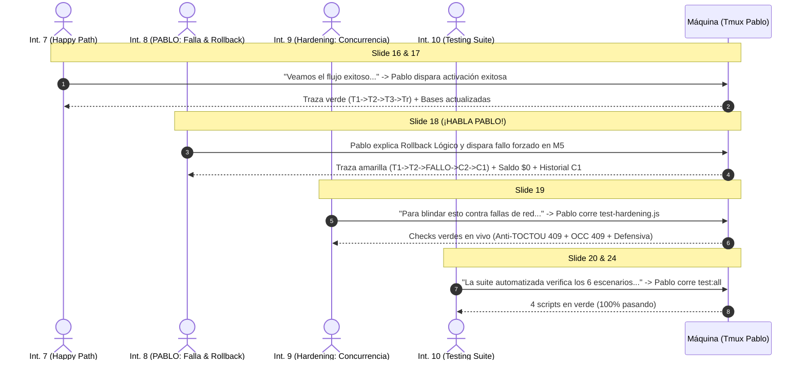

# 🎵 LA PARTITURA DEL OPERADOR — GRUPO 8
## Guión de Ejecución en Vivo para la Máquina (Pablo: Integrante 8 + Operador)

---

### 🖥️ Distribución de la Pantalla (`tmux`)
* **Panel 1 (Izquierda / Arriba):** Servidor corriendo en vivo (`npm run start:dist`). Muestra los logs coloreados en tiempo real.
* **Panel 2 (Derecha Arriba):** Consola de disparo (donde pegás los comandos cURL).
* **Panel 3 (Derecha Abajo):** Consola de auditoría (donde corrés los `curl` a `/inspeccionar-bases` o `/historial` formateados con `jq`).
* **Panel 4 (Pestaña / Fondo):** Consola de testing automatizado (`npm run test:all`).

---



---

## 🟢 ACTO 1: Habla INTEGRANTE 7 — Flujo Exitoso (Happy Path)
* **Slides:** 16 y 17 (*Activación Exitosa* y *El Orquestador*)
* **Tiempo:** Minuto 12:00 a 14:00

### 1. El compañero dice:
> *"Vamos a ver el circuito en tiempo real. Cuando una reserva entra en ventana de activación, M9 orquesta los tres servicios..."*

### 2. Vos ejecutás en el PANEL 2:
```bash
# 1. Crear reserva
RES_7=$(curl -s -X POST http://localhost:8090/reservas \
  -H "Content-Type: application/json" \
  -d '{"clienteId":"cli-demo","origen":"Av. Castelli 930","destino":"Aeropuerto","tarifaEstimada":3500}' | jq -r .reserva.id)

# 2. Activar Saga exitosa
curl -s -X POST http://localhost:8090/reservas/$RES_7/activar-saga \
  -H "Content-Type: application/json" \
  -H "Idempotency-Key: key-exito-$RES_7" \
  -d '{"forzarFalloM5": false}' | jq .
```

### 3. Qué mostrás:
* **En Panel 1 (Logs):** Apuntás la secuencia verde:
  `T1 (M9) -> Tc (M7: $3500) -> Tp (M5: Chofer Hernán) -> Tr (M8: Notificación) -> SAGA FINALIZADA`.
* **En Panel 3 (Auditoría):** Corrés:
  ```bash
  sqlite3 data/m9_reservas.db "SELECT id, cliente_id, estado, conductor_id FROM reservas ORDER BY creado_en DESC LIMIT 3;" -table
  sqlite3 data/m7_pagos.db "SELECT id, reserva_id, monto, estado FROM transacciones ORDER BY fecha_hora DESC LIMIT 3;" -table
  sqlite3 data/m5_despacho.db "SELECT id, reserva_id, estado, conductor_nombre FROM solicitudes_despacho ORDER BY fecha_hora DESC LIMIT 3;" -table
  ```
  *(Se ve: `cli-demo` en `ACTIVADA`, `PRE_AUTORIZADO`, `Hernán Fernández`).*

---

## 🟡 ACTO 2: ¡HABLAS VOS! INTEGRANTE 8 — Falla en Pivotante y Compensación ($C_2 \to C_1$)
* **Slide:** 18 (*FALLA LA PIVOTANTE · ROLLBACK LÓGICO EN ORDEN INVERSO: C2 → C1*)
* **Tiempo:** Minuto 14:00 a 16:00

### 1. Qué decís vos (Tu guión hablado):
> *"El caso exitoso es sencillo, pero el verdadero poder de una Saga aparece cuando las cosas fallan en el mundo real.
> 
> Supongamos que un pasajero solicita un viaje en una zona sin cobertura o en hora pico, y M5 no encuentra ningún chofer disponible.
> 
> Como cada microservicio tiene su propia base de datos física, no existe un `ROLLBACK` de SQL que deshaga todo mágicamente. Si la transacción pivotante falla, el orquestador tiene que ejecutar un **Rollback Lógico mediante Transacciones Compensatorias en orden estrictamente inverso**:
> 
> 1. **Compensación C2 sobre M7 Pagos:** M9 le ordena a M7 liberar la pre-autorización. El dinero retenido vuelve inmediatamente a \$0.
> 2. **Compensación C1 sobre M9 Reservas:** La reserva se marca como `VENCIDA` y se graba un evento inmutable en el historial de auditoría.
> 
> Además, implementamos **Compensación Defensiva**: si M7 llegara a estar caído al momento de devolver el dinero, la saga no crashea con error 500 dejando la reserva en el limbo; captura el fallo, marca la reserva como `REQUIERE_RECONCILIACION_MANUAL` y garantiza que la reserva pase a `VENCIDA`."*

### 2. Qué ejecutás vos en el PANEL 2 mientras hablás:
```bash
# 1. Crear reserva para romperla
RES_8=$(curl -s -X POST http://localhost:8090/reservas \
  -H "Content-Type: application/json" \
  -d '{"clienteId":"cli-falla","origen":"Barranqueras","destino":"UTN","tarifaEstimada":4200}' | jq -r .reserva.id)

# 2. Disparar forzando el fallo en M5
curl -s -X POST http://localhost:8090/reservas/$RES_8/activar-saga \
  -H "Content-Type: application/json" \
  -H "Idempotency-Key: key-falla-$RES_8" \
  -d '{"forzarFalloM5": true}' | jq .
```

### 3. Qué mostrás:
* **En Panel 1 (Logs):**
  `Tp (M5: FALLO) -> [SAGA ALERT] -> C2 (M7: Fondos liberados) -> C1 (M9: Reserva VENCIDA) -> SAGA COMPENSADA`.
* **En Panel 3 (Auditoría en M9 y saldo \$0 en M7):** Corrés:
  ```bash
  sqlite3 data/m9_reservas.db "SELECT id, reserva_id, tipo_evento, estado_nuevo, actor FROM historial_reservas ORDER BY id DESC LIMIT 4;" -table
  sqlite3 data/m7_pagos.db "SELECT id, reserva_id, monto, estado FROM transacciones ORDER BY fecha_hora DESC LIMIT 3;" -table
  ```
  *(Se ve: `actor: SAGA_COMPENSATION_C1`, `estado_nuevo: VENCIDA`, y en M7 `estado: LIBERADO`).*

### 4. Tu pase al siguiente compañero:
> *"Para explicar cómo blindamos esta Saga contra problemas de concurrencia y reintentos de red, le doy la palabra a mi compañera Avril Machuca."*

---

## 🔴 ACTO 3: Habla INTEGRANTE 9 — Hardening y Resiliencia en Concurrencia
* **Slide:** 19 (*Hardening · Resiliencia y Consistencia Operativa*)
* **Tiempo:** Minuto 16:00 a 18:00

### 1. El compañero dice:
> *"En producción pueden ocurrir reintentos de red automáticos o dos operadores intentando despachar la misma reserva al mismo tiempo. Para esto implementamos Idempotencia Atómica Anti-TOCTOU y Control de Concurrencia Optimista (OCC)..."*

### 2. Vos ejecutás en el PANEL 2:
```bash
node scripts/test-hardening.js
```

### 3. Qué se ve en pantalla:
Aparecen los checks en verde en vivo:
* `✔ Petición ganadora: HTTP 200 (Éxito)`
* `✔ Petición concurrente: HTTP 409 (Rechazada por Candado Atómico Anti-TOCTOU)`
* `✔ Transacciones en M7: 1 sola transacción ($3000) - CERO DOBLE COBRO`
* `✔ Bloqueada en T1 por OCC (HTTP 409: Estado ya no era CONFIRMADA)`
* `✔ Compensación Defensiva: Transición C1 garantizada ante caída de M7 (REQUIERE_RECONCILIACION_MANUAL)`

---

## 🔵 ACTO 4: Habla INTEGRANTE 10 — Testing Automatizado y Cierre
* **Slides:** 20 y 24 (*Evidencias* y *Límites y Próximos Pasos*)
* **Tiempo:** Minuto 18:00 a 20:00

### 1. El compañero dice:
> *"Para garantizar que ninguna regresión rompa la consistencia eventual, implementamos una suite integral automatizada que valida los flujos completos sobre las bases SQLite aisladas..."*

### 2. Vos ejecutás en el PANEL 4 (o Panel 2):
```bash
npm run test:all
```

### 3. Qué se ve en pantalla:
Compila con `tsc` y corre en fila:
1. `test-success.js` $\to$ **PASÓ**
2. `test-failure.js` $\to$ **PASÓ**
3. `test-hardening.js` $\to$ **PASÓ**
4. `test-coverage.js` $\to$ **6/6 TESTS PASADOS (100% BLINDADO)**

El compañero cierra con los trade-offs de la Slide 24 y dan las **GRACIAS** en la Slide 25.
