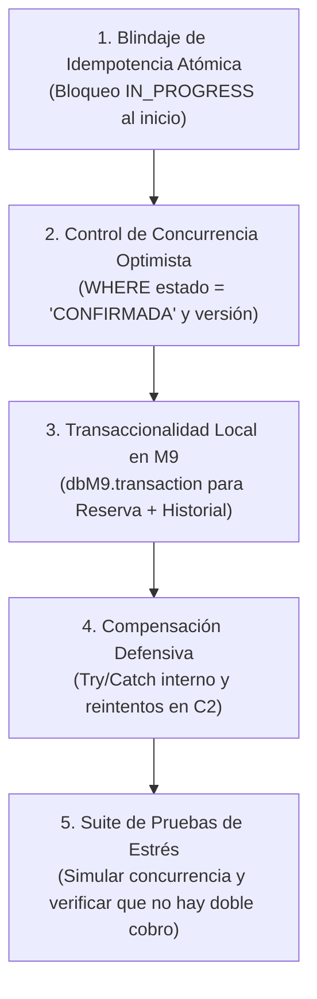

# 🏛️ Informe Consolidado de Investigación y Plan de Acción (Hardening)
**Cátedra:** Desarrollo de Software — UTN Facultad Regional Resistencia (2026)  
**Grupo:** 8 (10 Integrantes) — **Módulo Base:** M9 (Reservas de Viajes)  
**Temas:** Tema 11 (Consistencia: Saga) & Tema 12 (Persistencia: Database per Service)

---

## 📑 Índice de Contenidos

1. [Matriz de Trazabilidad: ¿Qué aportó cada documento al código actual?](#1-matriz-de-trazabilidad-qué-aportó-cada-documento-al-código-actual)
2. [El Algoritmo Central de la Saga: Del Bosquejo al Código Real](#2-el-algoritmo-central-de-la-saga-del-bosquejo-al-código-real)
3. [Hallazgos Teóricos y de Auditoría Rescatados](#3-hallazgos-teóricos-y-de-auditoría-rescatados)
4. [Plan de Acción Paso a Paso: Guía de Hardening de la Implementación](#4-plan-de-acción-paso-a-paso-guía-de-hardening-de-la-implementación)
5. [Pruebas de Verificación y Demostración Post-Arreglo](#5-pruebas-de-verificación-y-demostración-post-arreglo)

---

## 1. Matriz de Trazabilidad: ¿Qué aportó cada documento al código actual?

El código que hoy reside en `Implementacion/` es el resultado directo de la combinación de tres fuentes generadas por los distintos integrantes del equipo:

```
                      FUENTES DE INVESTIGACIÓN (GRUPO 8)
                                       │
      ┌────────────────────────────────┼────────────────────────────────┐
      ▼                                ▼                                ▼
[Doc 1: Agustín]                [Doc 2: Sol/Subgrupo B]          [Doc 3: Gianna]
TP_Investigacion_Grupo8_DS      Tp Investigacion.pdf             InvestigaciónTpp.md
(Marco formal / Módulo M9)      (Bosquejo funcional)             (Auditoría y Resiliencia)
      │                                │                                │
      ├─ Dominio real M9               ├─ Algoritmo Saga en JS          ├─ Anomalías Aislamiento
      ├─ Estados: CONFIRMADA,          ├─ Flag forceError: true/false   ├─ Control Concurrencia
      │  EN_PROCESO, ACTIVADA          ├─ Escenarios A (OK) y B (Fallo) ├─ Problema Dual-Write
      ├─ Tablas: reservas, historial   └─ 3 Bases independientes        └─ Semantic Locks
      └─ Rol de M2, M5, M7 y M8                 │                               │
                                                ▼                               ▼
                                  ┌──────────────────────────────┐
                                  │   CÓDIGO IMPLEMENTADO        │ ◄──── GUÍA DE HARDENING
                                  │   (Implementacion/src/...)   │       (Parches de seguridad)
                                  └──────────────────────────────┘
```

### Tabla Comparativa de Contribuciones:

| Concepto / Componente | Documento 1 (Agustín) | Documento 2 (Sol / Subgrupo B) | Documento 3 (Gianna) | Código Actual (`Implementacion/`) |
| :--- | :--- | :--- | :--- | :--- |
| **Escenario de Negocio** | Ventana de activación de reservas (M9). | Solicitud genérica de viajes. | Activación con compensación. | **M9 Reservas (Doc 1).** |
| **Estados de la Reserva** | `CONFIRMADA`, `EN_PROCESO_DESPACHO`, `ACTIVADA`, `VENCIDA`. | `PENDIENTE_PAGO`, `PAGO_AUTORIZADO`, `CONFIRMADO`, `CANCELADO`. | `CREADA`, `ASIGNANDO`, `CANCELADA_COMPENSADA`. | **Estados oficiales de M9 (Doc 1).** |
| **Lógica del Orquestador** | Diagrama de secuencia formal. | **Pseudocódigo `requestRideSaga` con `try/catch`.** | Máquina de estados formal. | **Algoritmo directo de Sol (Doc 2).** |
| **Inyección de Falla** | Sin especificar en código. | **Flag `forceError: true/false`.** | Cabecera `X-Simulate-Failure`. | **Body `{ forzarFalloM5: true }` (Doc 2).** |
| **Separación de Bases** | Esquema PostgreSQL en Docker. | **3 bases de datos aisladas.** | Configuración Docker Compose. | **3 SQLite independientes (Doc 2).** |
| **Idempotencia y Auditoría** | RF-9.10 y RF-9.12 requeridos. | Logs en consola. | **Tabla de deduplicación y logs correlacionados.** | **`IdempotencyRepo` + `HistoryRepo` (Doc 1 y 3).** |
| **Puntos Críticos / Fallas** | No analizados. | No analizados. | **Aislamiento, Dual-Write, Locks optimistas.** | **Vulnerabilidades detectadas.** |

---

## 2. El Algoritmo Central de la Saga: Del Bosquejo al Código Real

### 2.1. El Bosquejo Original (del PDF de Sol / Subgrupo B)
Este fragmento es el más claro para explicar conceptualmente en una diapositiva:

```javascript
async function requestRideSaga(rideData) {
  let paymentAuthorized = false;
  try {
    // 1. Bloqueo local
    const ride = await TravelService.createRide({ ...rideData, status: 'PENDIENTE_PAGO' });
    
    // 2. Transacción Compensable (Pago)
    await PaymentService.authorizePayment({ rideId: ride.id, amount: ride.fare });
    paymentAuthorized = true;

    // 3. Transacción Pivotante (Conductor)
    if (rideData.forceError) throw new Error("ERROR_NO_DRIVERS_AVAILABLE");
    await DriverService.assignDriver({ rideId: ride.id });

    // Éxito: Confirmación
    await TravelService.updateStatus(ride.id, 'CONFIRMADO');
    return { success: true };

  } catch (error) {
    // Compensación en orden inverso (Rollback Lógico)
    if (paymentAuthorized) {
      await PaymentService.refundPayment({ rideId: ride.id });
    }
    await TravelService.updateStatus(ride.id, 'CANCELADO_POR_FALTA_DE_CONDUCTORES');
    return { success: false, error: error.message };
  }
}
```

### 2.2. Cómo se tradujo a TypeScript en `activationSagaOrchestrator.ts`
En el código real se agregaron los tipos, DTOs y persistencia en SQLite:

```typescript
// T1: Transacción Local M9 (Semantic Lock)
ReservationRepository.actualizarEstado(reservaId, 'EN_PROCESO_DESPACHO');
HistoryRepository.registrar({ tipoEvento: 'ACTIVACION_INICIADA', ... });

// T2: Transacción Compensable en M7 (db_pagos)
const txPago = await M7Client.preAutorizarPago({ reservaId, monto }, requestId);
let pagoPreAutorizado = true;

// T3: Transacción Pivotante en M5 (db_despacho) -> PUNTO DE NO RETORNO
const despacho = await M5Client.solicitarDespacho({ reservaId, forzarFallo }, idempotencyKey);

// Confirmación: Estado ACTIVADA + Notificación Tr a M8
ReservationRepository.actualizarEstado(reservaId, 'ACTIVADA', { conductorId });
await M8Client.enviarNotificacion(...);
```

---

## 3. Hallazgos Teóricos y de Auditoría Rescatados (Documento de Gianna)

El archivo `InvestigaciónTpp.md` aporta los fundamentos para convertir esta PoC "vibe coded" en una arquitectura robusta:

1. **Pérdida de Aislamiento Global:**  
   En una Saga, cada transacción local hace `COMMIT`. Para evitar anomalías (*Dirty Reads* o *Lost Updates*), se requiere un **Bloqueo Semántico** (`EN_PROCESO_DESPACHO`) y validación de versión (**Optimistic Locking**).
2. **El Problema del *Dual-Write*:**  
   Modificar la base de datos local y llamar a un servicio externo secuencialmente no es atómico. Si el servidor colapsa entre $T_2$ y $T_3$, la plata queda retenida para siempre. En producción esto se resuelve con el **Transactional Outbox Pattern**.
3. **Fallas en la Compensación:**  
   Si la acción compensatoria $C_2$ (devolver la plata) falla por un corte de red, el sistema no puede limitarse a arrojar un error 500: debe haber reintentos automáticos garantizados.
4. **Idempotencia Atómica:**  
   La verificación y registro de la `Idempotency-Key` debe ser atómica al inicio del flujo, no un guardado pasivo al final.

---

## 4. Plan de Acción Paso a Paso: Guía de Hardening

Para blindar la implementación y subsanar las vulnerabilidades detectadas, seguí esta hoja de ruta en el código:



---

### Paso 1: Blindar la Idempotencia contra Concurrencia (TOCTOU)
* **Archivo afectado:** [`src/repositories/idempotencyRepository.ts`](file:///home/ArchTydas/UTN/3ro/Desarrollo/Extras-TPI/TPI-DS-2026-Testing/Implementacion/src/repositories/idempotencyRepository.ts) y [`src/saga/activationSagaOrchestrator.ts`](file:///home/ArchTydas/UTN/3ro/Desarrollo/Extras-TPI/TPI-DS-2026-Testing/Implementacion/src/saga/activationSagaOrchestrator.ts).
* **El problema actual:** Se consulta si la clave existe en la línea 32 y se guarda recién al final en la línea 175. Si dos peticiones entran juntas, ambas pasan y se cobra dos veces.
* **La solución a aplicar:**
  1. Agregar una columna `estado` en la tabla `idempotencia` (`'EN_PROCESO'` | `'COMPLETADO'`).
  2. Al inicio de la Saga, intentar insertar atómicamente la clave con estado `'EN_PROCESO'`.
  3. Si la inserción arroja colisión de clave primaria (`SQLITE_CONSTRAINT_PRIMARYKEY`), rechazar con HTTP 409 (*Solicitud en proceso*) o esperar la respuesta cacheada.
  4. Al finalizar la Saga, actualizar el registro a `'COMPLETADO'` con la respuesta definitiva.

---

### Paso 2: Control de Concurrencia Optimista (Evitar Doble Activación)
* **Archivo afectado:** [`src/repositories/reservationRepository.ts`](file:///home/ArchTydas/UTN/3ro/Desarrollo/Extras-TPI/TPI-DS-2026-Testing/Implementacion/src/repositories/reservationRepository.ts).
* **El problema actual:** `actualizarEstado` hace un `UPDATE reservas SET estado = ? WHERE id = ?` a ciegas.
* **La solución a aplicar:**
  Modificar la actualización para que sea condicional al estado esperado:
  ```sql
  UPDATE reservas 
  SET estado = 'EN_PROCESO_DESPACHO', actualizado_en = ?
  WHERE id = ? AND estado = 'CONFIRMADA';
  ```
  Si `stmt.run()` reporta `changes === 0`, significa que otro hilo o proceso ya tomó la reserva. Se lanza inmediatamente una excepción de concurrencia (`ConflictError: La reserva ya está siendo procesada`).

---

### Paso 3: Transaccionalidad Local en M9 (Atomicidad Reserva + Historial)
* **Archivo afectado:** [`src/repositories/reservationRepository.ts`](file:///home/ArchTydas/UTN/3ro/Desarrollo/Extras-TPI/TPI-DS-2026-Testing/Implementacion/src/repositories/reservationRepository.ts).
* **El problema actual:** Se actualiza `reservas` y luego se inserta en `historial_reservas` sin transacción. Si el proceso cae en el medio, la auditoría se pierde.
* **La solución a aplicar:**
  Utilizar el método de transacción de SQLite (`dbM9.exec('BEGIN')` o un wrapper transaccional):
  ```typescript
  export function actualizarConHistorial(reservaId: string, nuevoEstado: EstadoReserva, evento: HistorialEvento) {
    dbM9.exec('BEGIN TRANSACTION');
    try {
      // 1. Update reservas
      // 2. Insert historial_reservas
      dbM9.exec('COMMIT');
    } catch (err) {
      dbM9.exec('ROLLBACK');
      throw err;
    }
  }
  ```

---

### Paso 4: Compensación Defensiva en $C_2$ (Que la compensación no tumbe el server)
* **Archivo afectado:** [`src/saga/activationSagaOrchestrator.ts`](file:///home/ArchTydas/UTN/3ro/Desarrollo/Extras-TPI/TPI-DS-2026-Testing/Implementacion/src/saga/activationSagaOrchestrator.ts).
* **El problema actual:** Si `M7Client.liberarPreAutorizacion` falla dentro del `catch`, la excepción no se captura, nunca se ejecuta $C_1$ (marcar `VENCIDA`) y el servidor arroja HTTP 500 dejando la base en estado sucio.
* **La solución a aplicar:**
  1. Envolver la llamada a $C_2$ en su propio `try/catch` con reintentos mínimos (ej. 3 reintentos).
  2. Si agota los reintentos, marcar la reserva en M9 con un estado de alerta (`FALLO_COMPENSACION_PAGO`) para intervención o auditoría, pero **garantizar que la ejecución continúe hasta auditar el fallo**.

---

### Paso 5: Demostración de Desacoplamiento de Esquema (Idea de Gianna)
* **Objetivo:** Demostrar en vivo ante los profesores que hay verdadero *Database per Service*.
* **Paso a paso para la demo:**
  1. Abrir `m5_despacho.db` y alterar la tabla `conductores` (ejemplo: cambiar la columna `vehiculo` a `vehiculo_patente` y `vehiculo_modelo`).
  2. Modificar únicamente el código interno de `M5Client.ts` para que mapee esos dos campos al DTO público `{ vehiculo }`.
  3. Ejecutar la demo (`npm run demo`).
  4. Mostrar que M9 sigue funcionando intacto sin haber tocado una sola línea de M9 ni su esquema.

---

## 5. Pruebas de Verificación y Demostración Post-Arreglo

Una vez aplicados los parches anteriores, el arnés de pruebas debe validar:

1. **Test de Concurrencia Simultánea:**  
   Dos peticiones concurrentes con la misma `Idempotency-Key` $\to$ Solo una ejecuta la Saga, la otra recibe HTTP 409 o la respuesta en caché. En `db_pagos` debe haber **exactamente una pre-autorización**, nunca dos.
2. **Test de Falla de Compensación Simulada:**  
   Forzar error en M7 durante la liberación de fondos $\to$ Verificar que M9 no crashea, registra la auditoría y deja el incidente documentado.
3. **Test de Happy Path y Fallo Existente:**  
   `npm run test:all` sigue pasando en 100% de aserciones.

