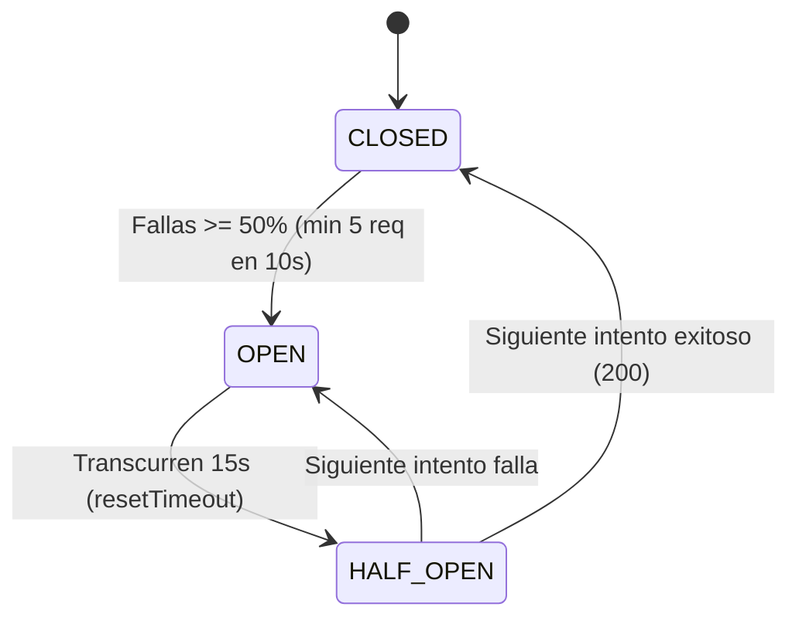
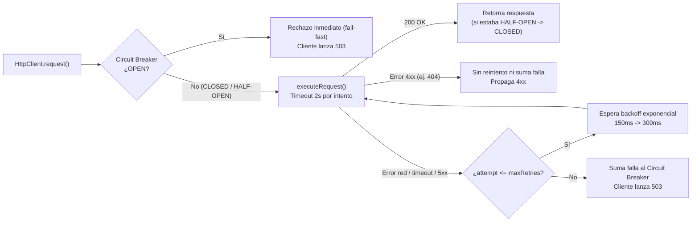

# Informe Técnico — Resiliencia HTTP: Circuit Breaker, Umbrales y Backoff Exponencial (M9)

> **Rama:** `fix/resilienciaHTTP_manejodeErrores`  
> **Requerimientos vinculados:** **RNF-09** (Idempotencia), **RNF-13** (Resiliencia: timeouts, reintentos limitados y tratamiento explícito de indisponibilidad sin bloqueos indefinidos)

---

## 📋 Resumen de tareas implementadas

| Tarea | Estado | Archivos principales |
| :--- | :--- | :--- |
| **1. Patrón Circuit Breaker (`opossum`)** | Implementado | [package.json](file:///home/fabrialca/2026-08-TPI/package.json), [httpClient.ts](file:///home/fabrialca/2026-08-TPI/src/clients/httpClient.ts) |
| **2. Configuración de Umbrales** | Implementado | [httpClient.ts](file:///home/fabrialca/2026-08-TPI/src/clients/httpClient.ts) |
| **3. Reintentos con Backoff Exponencial** | Implementado | [httpClient.ts](file:///home/fabrialca/2026-08-TPI/src/clients/httpClient.ts), [m2Client.ts](file:///home/fabrialca/2026-08-TPI/src/clients/m2Client.ts), [m5Client.ts](file:///home/fabrialca/2026-08-TPI/src/clients/m5Client.ts) |
| **Pruebas unitarias de resiliencia** | Implementado | [httpClient.test.ts](file:///home/fabrialca/2026-08-TPI/tests/unit/httpClient.test.ts) |

---

## 1. Patrón Circuit Breaker (`opossum` en `src/clients/httpClient.ts`)

### Qué se cambió y por qué
* Se instalaron `opossum` (`^10.0.0`) y `@types/opossum` (`^8.1.9`) en [package.json](file:///home/fabrialca/2026-08-TPI/package.json) (y `package-lock.json`).
* En [httpClient.ts](file:///home/fabrialca/2026-08-TPI/src/clients/httpClient.ts), se separó la lógica original de `fetch` + `AbortController` en el método privado `executeRequest`, y se envolvió su ejecución mediante `CircuitBreaker` dentro de `HttpClient.request`.
* **Por qué era necesario:** Sin Circuit Breaker, si un módulo externo (`M2`, `M4`, `M5` o `M7`) se caía o quedaba colgado, cada petición entrante a M9 debía esperar el timeout completo antes de responder `503`. Con `opossum`, tras detectar fallas reiteradas el circuito se abre y responde en **fail-fast (< 1 ms)** con error `503`, evitando saturar al módulo caído y protegiendo los hilos/conexiones de M9.

### Cómo funciona internamente
1. **Un Circuit Breaker independiente por módulo (`getOrCreateBreaker`):**
   * `HttpClient` mantiene un `Map` estático (`breakers`) indexado por el `origin` de la URL (`new URL(url).origin`, por ejemplo `http://m2-clientes:8082`, `http://m4-ubicacion:8084`, `http://m5-despacho:8085`, `http://m7-tarifas:8087`).
   * **Ventaja 1 (Aislamiento):** Si se cae `M4`, solo se abre el circuito de `M4`; `M2`, `M5` y `M7` siguen operando normalmente.
   * **Ventaja 2 (Agrupación por servicio):** Distintos endpoints del mismo módulo (como `/api/v1/tarifas/estimar` y `/api/v1/tarifas/cancelacion` en `M7`) comparten el mismo circuito.
   * **Ventaja 3 (Transparencia):** No fue necesario modificar las llamadas en `M4Client` ni `M7Client`, y cuando el circuito está abierto `breaker.fire()` rechaza inmediatamente, cayendo en el `catch` de cada cliente para devolver `AppError` `503`.
2. **Filtro de errores de negocio (`errorFilter`):**
   * Ignora códigos HTTP `4xx` (`status >= 400 && status < 500`) en las estadísticas del circuito.
   * **Por qué:** Si `M2` responde `404` porque un cliente no existe, es una respuesta de negocio válida, no una caída del servicio `M2`. Sin este filtro, consultar varios IDs inexistentes abriría el circuito de `M2` y provocaría `503` para usuarios válidos.
3. **Observabilidad y limpieza (`resetBreakers`):**
   * Se registran en consola las transiciones de estado `open`, `halfOpen` y `close` indicando el `origin` afectado.
   * `HttpClient.resetBreakers()` ejecuta `breaker.shutdown()` y limpia el `Map` para evitar timers pendientes en suites de Jest.

---

## 2. Configuración de Umbrales

### Valores definidos en [httpClient.ts](file:///home/fabrialca/2026-08-TPI/src/clients/httpClient.ts#L14-L27) y su porqué

| Parámetro | Valor | Ubicación | Motivo técnico |
| :--- | :--- | :--- | :--- |
| **Timeout por intento** | `2000 ms` (`2s`) | `DEFAULT_TIMEOUT_MS` + `AbortController` | Corta cada intento HTTP que supere 2 segundos para evitar bloqueos indefinidos (**RNF-13**). |
| **Timeout de `opossum`** | `false` | `breakerOptions.timeout` | Delega el timeout por intento al `AbortController` de 2s. Si `opossum` tuviera un timeout fijo corto, abortaría el circuito antes de permitir un reintento válido. |
| **Umbral de fallos** | `50%` | `errorThresholdPercentage: 50` | Abre el circuito cuando al menos la mitad de las peticiones en la ventana fallan. |
| **Volumen mínimo** | `5` peticiones | `volumeThreshold: 5` | Evita abrir el circuito ante 1 fallo aislado al inicio; exige al menos 5 peticiones en la ventana estadística. |
| **Ventana estadística** | `10000 ms` (`10s`) | `rollingCountTimeout: 10000` | Ventana móvil sobre la cual `opossum` calcula el porcentaje de fallos. |
| **Enfriamiento (`HALF-OPEN`)** | `15000 ms` (`15s`) | `resetTimeout: 15000` | Tiempo que permanece `OPEN` (fail-fast) antes de pasar a `HALF-OPEN` para probar si el módulo externo se recuperó. |

---

## 3. Reintentos con Backoff Exponencial

### Qué se cambió y por qué
Antes de esta mejora, `executeRequest` en [httpClient.ts](file:///home/fabrialca/2026-08-TPI/src/clients/httpClient.ts) tenía dos limitaciones:
1. Usaba una **espera fija de `150ms`** en lugar de una progresión exponencial.
2. La condición `if (attempt <= maxRetries && method === 'GET')` **ignoraba el `retries: 1` de `M5Client`** (porque `M5` usa `POST`) y **reintentaba incluso respuestas `404`** en peticiones `GET` de `M2`.

Se aplicaron los siguientes cambios:
1. **Backoff exponencial genérico en `HttpClient`:**
   * Se agregó `retryBaseDelayMs?: number` a `RequestOptions` (default `150ms`).
   * Se creó `HttpClient.calculateBackoffDelay(attempt, baseDelayMs)` con la fórmula `baseDelayMs * 2^(attempt - 1)`, generando retardos progresivos: `150ms` (1er reintento) → `300ms` (2do reintento) → `600ms` (3er reintento).
   * Se corrigió la condición de reintento a `if (attempt <= maxRetries && !isClientError)`:
     * No reintenta respuestas `4xx` (como el `404` de `M2`), evitando llamadas duplicadas y esperas innecesarias.
     * Respeta `retries` tanto en `GET` como en `POST` idempotentes que lo soliciten explícitamente.
     * Solo cuenta como falla en el Circuit Breaker si la petición falla **después** de agotar sus reintentos.
2. **Política por cliente (100% reversible por módulo):**
   * **[m2Client.ts](file:///home/fabrialca/2026-08-TPI/src/clients/m2Client.ts#L18-L22):** Configura `retries: 2` (`GET` idempotente de consulta de estado de cuenta). Ante fallos transitorios ejecuta: intento inicial → `150ms` → reintento 1 → `300ms` → reintento 2.
   * **[m5Client.ts](file:///home/fabrialca/2026-08-TPI/src/clients/m5Client.ts#L38-L41):** Configura `retries: 2` (seguro gracias al header `Idempotency-Key`, acorde a **RF-9.10 / RNF-09**).
   * **[m4Client.ts](file:///home/fabrialca/2026-08-TPI/src/clients/m4Client.ts) y [m7Client.ts](file:///home/fabrialca/2026-08-TPI/src/clients/m7Client.ts):** Se mantienen sin `retries` (`0` reintentos por defecto para `POST`), evitando reejecutar cálculos o arriesgar operaciones de cancelación financiera mientras se confirma la idempotencia con el grupo de M7. Si en el futuro se decide habilitar o cambiar reintentos en cualquiera de los 4 módulos, alcanza con editar la propiedad `retries` en la llamada de ese cliente puntual.

---

## 🧪 Pruebas unitarias y verificación

Se creó la suite [tests/unit/httpClient.test.ts](file:///home/fabrialca/2026-08-TPI/tests/unit/httpClient.test.ts) con **7 pruebas unitarias** que verifican:
1. Creación de Circuit Breakers independientes por módulo (`M2`, `M4`, `M5`, `M7`) y compartición entre rutas del mismo origen (`M7`).
2. Apertura del circuito tras superar el umbral de fallos y rechazo inmediato (`503`) sin invocar `fetch`.
3. Aislamiento entre módulos: la apertura del circuito de `M4` no afecta llamadas exitosas a `M2`.
4. Errores `4xx` (`404` en `M2`): no abren el circuito ni ejecutan reintentos duplicados.
5. Reintentos con backoff exponencial en `M5Client` (`POST` con `Idempotency-Key` y `retries: 2`) validando retardos `150ms` y `300ms`.
6. Cálculo progresivo de `calculateBackoffDelay` (`150ms -> 300ms -> 600ms`) y uso de `retryBaseDelayMs`.
7. Transición de `OPEN` → `HALF-OPEN` tras `resetTimeout` y recuperación a `CLOSED` ante respuesta `200 OK`.

### Resultados verificados tras los últimos cambios
* `./node_modules/.bin/tsc --noEmit`: **0 errores de compilación**.
* `npm test`: **11/11 suites aprobadas — 65/65 tests aprobados**.
