# Mapa de Arquitectura: Del Contrato OpenAPI 3.1.0 al Código TypeScript (M9)

Este documento es el mapa de navegación completo del proyecto. Muestra cómo cada endpoint definido en `openapi.yaml` (versión OpenAPI 3.1.0 unificada e intercambiable con el Grupo 9) viaja a través de las capas de la aplicación (Rutas, Middlewares, Controladores, Servicios, Scheduler en segundo plano, Repositorios, Clientes Externos y Base de Datos) abarcando todos los archivos de `src/`.

---

## 1. Diagrama de Flujo General de Arquitectura

El siguiente diagrama Mermaid representa el flujo de ejecución completo desde que entra una petición HTTP hasta que impacta en la persistencia, los servicios en segundo plano o en módulos externos:

```mermaid
flowchart TD
    %% Contrato y Entrada
    subgraph S_CONTRATO ["0. Contrato de la API"]
        YAML["openapi.yaml<br/>(Contrato REST OpenAPI 3.1.0 Unificado con Grupo 9)"]
    end

    subgraph S_ENTRY ["1. Entrada y Arranque del Servidor"]
        INDEX["src/index.ts<br/>(Arranque HTTP en puerto 8089, conexión DB y ciclo Scheduler)"]
        APP["src/app.ts<br/>(Configuración de Express, CORS y montaje de rutas)"]
        ENV["src/config/env.ts<br/>(Lectura tipada de variables de entorno)"]
        DB["src/config/database.ts<br/>(Pool de PostgreSQL y conexión)"]
        SCHED["src/services/schedulerService.ts<br/>(ReservationScheduler: revisa reservas a 20 min)"]
    end

    subgraph S_MIDDLEWARES ["2. Middlewares Globales y de Seguridad"]
        REQ_ID["src/middlewares/requestId.ts<br/>(Asigna y propaga X-Request-Id)"]
        AUTH["src/middlewares/auth.ts<br/>(Verifica JWT y valida roles: CLIENTE, CONDUCTOR, OPERADOR, SERVICIO)"]
        ERR_HANDLER["src/middlewares/errorHandler.ts<br/>(Captura excepciones: formato RNF-03 { codigo, mensaje, detalle })"]
        NOT_FOUND["src/middlewares/notFoundHandler.ts<br/>(Manejo 404 Not Found estandarizado)"]
    end

    subgraph S_ROUTES ["3. Rutas de la Aplicación"]
        R_RESERVAS["src/routes/reservationRoutes.ts<br/>(/reservas/*)"]
        R_HEALTH["src/routes/healthRoutes.ts<br/>(/health)"]
        R_DOCS["src/routes/docRoutes.ts<br/>(/docs y /openapi.yaml)"]
    end

    subgraph S_CONTROLLERS ["4. Controladores (Validación Zod y Respuestas)"]
        C_RES["src/controllers/reservationController.ts<br/>(RespuestaCreacion: { mensaje, motivo, reserva, condiciones })"]
        C_ACT["src/controllers/activationController.ts<br/>(POST /reservas/:id/activar y Webhook M5 /despacho)"]
        C_HLT["src/controllers/healthController.ts<br/>(Estado del servicio y base de datos)"]
    end

    subgraph S_SERVICES ["5. Servicios de Negocio (Lógica Central)"]
        S_RES["src/services/reservationService.ts<br/>(Ciclo de vida, validación 409 idempotencia y cálculo)"]
        S_ACT["src/services/activationService.ts<br/>(Activación hacia M5 y retorno de ReservaDTO completo)"]
        S_VAL["src/services/anticipationValidator.ts<br/>(Valida anticipación de 30 min a 30 días)"]
    end

    subgraph S_CLIENTS ["6. Clientes HTTP Salientes (Sin fallbacks silenciosos a mocks)"]
        HTTP_CORE["src/clients/httpClient.ts<br/>(Fetch central con timeouts y reintentos)"]
        SEC_TOKEN["src/clients/serviceToken.ts<br/>(Genera JWT con rol SERVICIO)"]
        CLI_M2["src/clients/m2Client.ts<br/>(Consulta estado en M2 Clientes -> 503 si cae)"]
        CLI_M4["src/clients/m4Client.ts<br/>(Valida cobertura y distancia en M4 -> 503 si cae)"]
        CLI_M5["src/clients/m5Client.ts<br/>(Envía despacho a M5 con Idempotency-Key -> 503 si cae)"]
        CLI_M7["src/clients/m7Client.ts<br/>(Cotiza tarifa estimada en M7 -> 503 si cae)"]
        CLI_M8["src/clients/m8Client.ts<br/>(Notifica eventos asíncronos a M8 Notificaciones)"]
    end

    subgraph S_REPOSITORIES ["7. Persistencia y Auditoría"]
        REPO_RES["src/repositories/reservationRepository.ts<br/>(CRUD SQL / Memoria y buscarPendientesDeActivacion)"]
        REPO_HIS["src/repositories/historyRepository.ts<br/>(Auditoría no destructiva de eventos con EntradaHistorial)"]
        REPO_IDEM["src/repositories/idempotencyRepository.ts<br/>(Registro y verificación de claveIdempotencia)"]
        SQL_SCHEMA["sql/01_init_schema.sql<br/>(Tablas relacionales: reservas, historial, idempotencia)"]
    end

    subgraph S_TYPES ["8. Modelos y Tipos de TypeScript"]
        T_AUTH["src/types/auth.ts<br/>(Roles, JwtUserPayload, Express.Request)"]
        T_RES["src/types/reservation.ts<br/>(ReservaDTO, RespuestaCreacion, Enums)"]
        T_PROB["src/types/problem.ts<br/>(Clase AppError y ProblemDetails)"]
    end

    %% Relaciones de Flujo
    YAML -.->|Define especificación formal de| APP
    INDEX --> APP
    INDEX --> DB
    INDEX --> ENV
    INDEX --> SCHED

    SCHED --> REPO_RES
    SCHED --> S_ACT

    APP --> REQ_ID
    APP --> R_HEALTH
    APP --> R_DOCS
    APP --> R_RESERVAS
    APP --> NOT_FOUND
    APP --> ERR_HANDLER

    R_HEALTH --> C_HLT
    R_DOCS --> YAML

    R_RESERVAS --> AUTH
    AUTH --> T_AUTH
    AUTH -.->|Si falla token| ERR_HANDLER

    R_RESERVAS --> C_RES
    R_RESERVAS --> C_ACT

    C_RES --> S_RES
    C_ACT --> S_ACT

    S_RES --> S_VAL
    S_RES --> REPO_IDEM
    S_RES --> REPO_RES
    S_RES --> REPO_HIS
    S_RES --> CLI_M2
    S_RES --> CLI_M4
    S_RES --> CLI_M7
    S_RES --> CLI_M8

    S_ACT --> CLI_M5
    S_ACT --> CLI_M8
    S_ACT --> REPO_RES
    S_ACT --> REPO_HIS

    CLI_M2 --> HTTP_CORE
    CLI_M4 --> HTTP_CORE
    CLI_M5 --> HTTP_CORE
    CLI_M7 --> HTTP_CORE
    CLI_M8 --> HTTP_CORE
    HTTP_CORE --> SEC_TOKEN

    REPO_RES --> DB
    REPO_HIS --> DB
    REPO_IDEM --> DB
    DB --> SQL_SCHEMA

    S_RES -.->|Lanza AppError| ERR_HANDLER
    C_RES -.->|ZodError| ERR_HANDLER
    ERR_HANDLER --> T_PROB
```

---

## 2. Mapa Rápido: ¿A dónde viaja cada Endpoint de la API?

Usá esta tabla de consulta rápida para saber qué archivos intervienen según el endpoint que estés mirando:

| Endpoint en `openapi.yaml` | Método | Ruta TypeScript (`src/routes/`) | Controlador (`src/controllers/`) | Servicio que resuelve (`src/services/`) | Repositorio / Cliente externo |
| :--- | :---: | :--- | :--- | :--- | :--- |
| `/health` | `GET` | `healthRoutes.ts` | `healthController.ts` | Consulta directa a DB | `database.ts` |
| `/docs` | `GET` | `docRoutes.ts` | Sirve Swagger UI | N/A | `openapi.yaml` |
| `/reservas` | `POST` | `reservationRoutes.ts` | `reservationController.ts` (`crear`) | `reservationService.ts` (`crearReserva`) | `m2Client`, `m4Client`, `m7Client`, `m8Client`, `reservationRepository`, `idempotencyRepository` |
| `/reservas` | `GET` | `reservationRoutes.ts` | `reservationController.ts` (`listar`) | `reservationService.ts` (`listarPorCliente`) | `reservationRepository` |
| `/reservas/{id}` | `GET` | `reservationRoutes.ts` | `reservationController.ts` (`obtenerPorId`) | `reservationService.ts` (`obtenerPorId` con rol `CONDUCTOR`) | `reservationRepository` |
| `/reservas/{id}` | `PATCH` | `reservationRoutes.ts` | `reservationController.ts` (`modificar`) | `reservationService.ts` (`modificarReserva`) | `m4Client`, `m7Client`, `m8Client`, `reservationRepository`, `historyRepository` |
| `/reservas/{id}/cancelar`| `POST` | `reservationRoutes.ts` | `reservationController.ts` (`cancelar`) | `reservationService.ts` (`cancelarReserva`) | `m8Client`, `reservationRepository`, `historyRepository` |
| `/reservas/{id}/historial`| `GET` | `reservationRoutes.ts` | `reservationController.ts` (`historial`) | `historyRepository.ts` (`listarPorReservaId`) | `historyRepository` (formato `EntradaHistorial`) |
| `/reservas/{id}/activar` | `POST` | `reservationRoutes.ts` | `activationController.ts` (`activar`) | `activationService.ts` (`activarReserva` -> devuelve `ReservaDTO`) | `m5Client`, `reservationRepository`, `historyRepository` |
| `/reservas/{id}/despacho`| `POST` | `reservationRoutes.ts` | `activationController.ts` (`webhookDespacho`) | `activationService.ts` (`procesarResultadoDespacho`) | `m8Client`, `reservationRepository`, `historyRepository` |

---

## 3. Catálogo de Archivos del Proyecto y Suites de Pruebas

Para tener la foto completa de todos los archivos que componen el backend:

### Configuración y Arranque (Raíz y `src/config/`)
1. `Dockerfile`: Define la compilación de la imagen del contenedor en 2 etapas.
2. `docker-compose.yml`: Orquesta el contenedor de la aplicación y la base de datos PostgreSQL.
3. `package.json`: Scripts de compilación (`build`), ejecución (`start`, `dev`) y tests (`test`).
4. `tsconfig.json`: Reglas estrictas del compilador de TypeScript (`target: ES2022`, `strict: true`).
5. `tests/tsconfig.json`: Extensión de tipado TypeScript para Jest en VS Code.
6. `jest.config.js`: Configuración del entorno de tests automatizados con `ts-jest`.
7. `.gitignore`: Protección estricta de secretos, variables `.env` y directorios compilados.
8. `.env.example`: Plantilla de variables de entorno requeridas.
9. `openapi.yaml`: El contrato de la API en formato OpenAPI 3.1.0 (unificado con Grupo 9).
10. `sql/01_init_schema.sql`: Script DDL que crea las 3 tablas relacionales y sus índices.
11. `src/index.ts`: Punto de entrada del proceso Node.js (conecta DB, inicia scheduler y escucha en puerto 8089).
12. `src/app.ts`: Inicializa Express, aplica CORS, JSON parser y enlaza las rutas.
13. `src/config/env.ts`: Centraliza la lectura de variables de entorno con fallbacks seguros.
14. `src/config/database.ts`: Administra el Pool de conexiones hacia PostgreSQL.

### Middlewares (`src/middlewares/`)
15. `src/middlewares/requestId.ts`: Inyecta o propaga el encabezado `X-Request-Id` para trazabilidad.
16. `src/middlewares/auth.ts`: Decodifica el token JWT y valida roles (`CLIENTE`, `CONDUCTOR`, `OPERADOR`, `SERVICIO`).
17. `src/middlewares/errorHandler.ts`: Captura errores no controlados y formatea la respuesta común RNF-03 `{ codigo, mensaje, detalle }` e interfaz `ProblemDetails`.
18. `src/middlewares/notFoundHandler.ts`: Responde `404 Not Found` en formato estructurado ante rutas inexistentes.

### Rutas y Controladores (`src/routes/` y `src/controllers/`)
19. `src/routes/reservationRoutes.ts`: Define las URLs y autorizaciones de roles para cada endpoint.
20. `src/routes/healthRoutes.ts`: Ruta para monitoreo de salud del servicio (`/health`).
21. `src/routes/docRoutes.ts`: Rutas para servir Swagger UI (`/docs`) y el YAML crudo (`/openapi.yaml`).
22. `src/controllers/reservationController.ts`: Valida esquemas Zod y envuelve las respuestas en el formato común `RespuestaCreacion`.
23. `src/controllers/activationController.ts`: Controla la activación manual hacia M5 y la recepción del webhook de despacho.
24. `src/controllers/healthController.ts`: Ejecuta un ping a la base de datos y responde el estado operativo.

### Lógica de Negocio y Tareas en Segundo Plano (`src/services/`)
25. `src/services/reservationService.ts`: Orquesta la creación, validación de clientes en M2, cotización en M7, modificación, cancelación y validación de idempotencia estricta (409).
26. `src/services/activationService.ts`: Gestiona el envío de la solicitud de despacho a M5 y la transición de estados. Retorna la entidad `ReservaDTO` completa.
27. `src/services/schedulerService.ts`: `ReservationScheduler` en segundo plano que busca periódicamente reservas confirmadas dentro de la ventana de 20 minutos y dispara la activación automática hacia M5 (RF-9.9).
28. `src/services/anticipationValidator.ts`: Aplica la regla temporal de anticipación (30 minutos a 30 días).

### Persistencia y Auditoría (`src/repositories/`)
29. `src/repositories/reservationRepository.ts`: CRUD SQL sobre tabla `reservas` (con soporte en memoria y método `buscarPendientesDeActivacion`).
30. `src/repositories/historyRepository.ts`: Registra y consulta la auditoría inmutable de eventos mapeando a `EntradaHistorial`.
31. `src/repositories/idempotencyRepository.ts`: Guarda y verifica claves de idempotencia en `registro_idempotencia`.

### Clientes de Integración Saliente (`src/clients/`)
32. `src/clients/httpClient.ts`: Cliente HTTP central con timeouts y reintentos.
33. `src/clients/serviceToken.ts`: Genera tokens JWT firmados con rol `SERVICIO` para autenticarse ante otros módulos.
34. `src/clients/m2Client.ts`: Consulta estado en M2 Clientes (lanza 503 si falla en integración).
35. `src/clients/m4Client.ts`: Valida cobertura y distancia en M4 Ubicación (lanza 503 si falla en integración).
36. `src/clients/m5Client.ts`: Envía despacho a M5 Solicitud con `Idempotency-Key` (lanza 503 si falla en integración).
37. `src/clients/m7Client.ts`: Solicita cotización de tarifa a M7 Tarifas (lanza 503 si falla en integración).
38. `src/clients/m8Client.ts`: Publica eventos de notificación hacia M8 Notificaciones.

### Modelos y Definiciones de Tipos (`src/types/`)
39. `src/types/auth.ts`: Roles (`CLIENTE`, `CONDUCTOR`, `OPERADOR`, `SERVICIO`) y payload del JWT.
40. `src/types/reservation.ts`: DTOs, entidades SQL, respuestas unificadas y enumeraciones del ciclo de vida.
41. `src/types/problem.ts`: Clase `AppError` e interfaz del estándar RFC 7807 (`ProblemDetails`).

---

## 4. Cobertura de Pruebas Automatizadas (49 Tests / 9 Suites)

La suite de pruebas ejecuta al 100% con `npm test`:

1. `tests/unit/anticipationValidator.test.ts` (5 tests): Validación de ventana de 30 min a 30 días y zonas horarias.
2. `tests/unit/reservationValidation.test.ts` (4 tests): Esquemas Zod de creación, vehículos y cancelación.
3. `tests/unit/schedulerService.test.ts` (3 tests): Detección y activación automática a 20 min (RF-9.9).
4. `tests/unit/m2Client.test.ts` (3 tests): Pruebas de fallback y manejo de errores 503 ante caída de M2.
5. `tests/unit/m4Client.test.ts` (3 tests): Pruebas de fallback y manejo de errores 503 ante caída de M4.
6. `tests/unit/m5Client.test.ts` (3 tests): Pruebas de fallback y manejo de errores 503 ante caída de M5.
7. `tests/unit/m7Client.test.ts` (3 tests): Pruebas de fallback y manejo de errores 503 ante caída de M7.
8. `tests/integration/health.test.ts` (4 tests): Healthcheck, Swagger UI, YAML y rutas no encontradas.
9. `tests/integration/activationAndWebhook.test.ts` (8 tests): Flujo de despacho a M5, permisos y webhook callback.
10. `tests/integration/reservationLifecycle.test.ts` (17 tests): Ciclo de vida completo, validaciones de negocio, idempotencia estricta (409) y auditoría.
