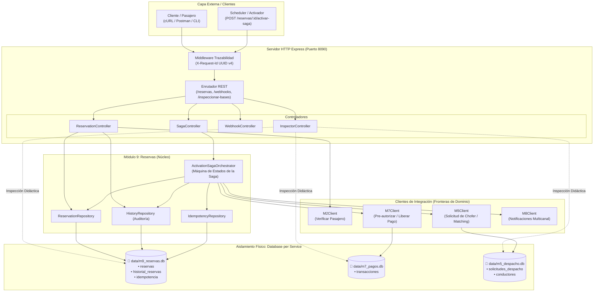
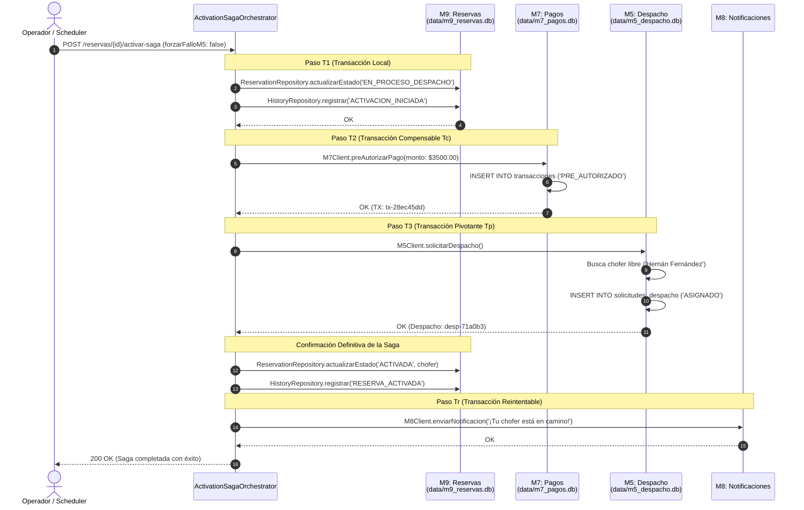
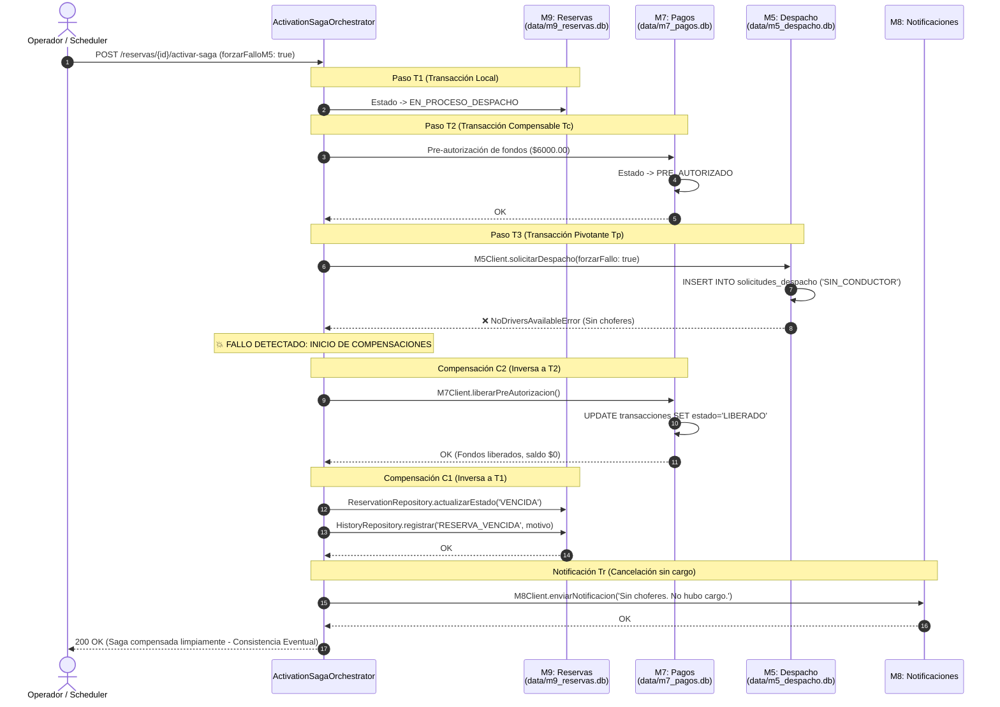

# 📘 Manual Maestro: Implementación Práctica de Saga Orquestada y Database per Service
**Cátedra:** Desarrollo de Software — UTN Facultad Regional Resistencia (2026)  
**Grupo:** 8 (10 Integrantes) — **Módulo Base Asignado:** Módulo 9 (M9 - Reservas de Viajes)  
**Temas de Investigación:** Tema 11 (Consistencia: Patrón Saga) & Tema 12 (Persistencia: Base de Datos por Servicio)

---

## 📑 Índice de Contenidos

1. [Contexto del Proyecto y Escenario de Investigación](#1-contexto-del-proyecto-y-escenario-de-investigación)
2. [Mapa de Arquitectura del Sistema Implementado](#2-mapa-de-arquitectura-del-sistema-implementado)
3. [Eje de Persistencia: Database per Service y Data Ownership](#3-eje-de-persistencia-database-per-service-y-data-ownership)
4. [Eje de Consistencia: Patrón Saga Orquestado y Máquina de Estados](#4-eje-de-consistencia-patrón-saga-orquestado-y-máquina-de-estados)
5. [Diagramas de Secuencia: Flujos de Ejecución](#5-diagramas-de-secuencia-flujos-de-ejecución)
   - 5.1. Flujo Exitoso (Happy Path)
   - 5.2. Flujo con Falla y Compensación Inversa (Rollback Lógico)
6. [Resiliencia, Trazabilidad e Idempotencia](#6-resiliencia-trazabilidad-e-idempotencia)
7. [Desglose Técnico Archivo por Archivo de `Implementacion/`](#7-desglose-técnico-archivo-por-archivo-de-implementacion)
8. [Guía de Puesta en Marcha, Pruebas y Verificación](#8-guía-de-puesta-en-marcha-pruebas-y-verificación)
9. [Matriz Comparativa de Estados en las 3 Bases de Datos](#9-matriz-comparativa-de-estados-en-las-3-bases-de-datos)
10. [Guía Rápida para Defensa en Coloquio](#10-guía-rápida-para-defensa-en-coloquio)

---

## 1. Contexto del Proyecto y Escenario de Investigación

En el marco del Trabajo Práctico Integrador (TPI) de Desarrollo de Software (UTN FRRe 2026), se diseña y construye una **Plataforma Distribuida de Movilidad Urbana** compuesta por 9 microservicios:
* **M1:** Autenticación y Autorización.
* **M2:** Gestión de Clientes.
* **M3:** Gestión de Conductores.
* **M4:** Ubicación y Cobertura Geoespacial.
* **M5:** Solicitud y Despacho de Viajes.
* **M6:** Ejecución y Telemetría de Viajes.
* **M7:** Tarifas y Cobros.
* **M8:** Notificaciones Multicanal.
* **M9:** Reservas Programadas de Viajes (Módulo asignado al **Grupo 8**).

### El Problema de Fondo
* **El Antipatrón de la Base de Datos Compartida (*Shared Database*):** En arquitecturas distribuidas, compartir una base de datos única anula la autonomía de los equipos, acopla los esquemas relacionales, genera contención y bloqueos por concurrencia, e imposibilita la persistencia políglota.
* **La Imposibilidad del Bloqueo Global (*2-Phase Commit / 2PC*):** En microservicios no se pueden utilizar transacciones ACID globales distribuidas (protocolo 2PC/XA) debido a que bloquean recursos de red, introducen un Punto Único de Falla (SPOF) y son incompatibles con servicios externos como pasarelas de pago.

### La Solución Implementada en `Implementacion/`
Se desarrolló una **Prueba de Concepto (PoC) integral y ejecutable en TypeScript y Node.js** que combina ambos temas:
1. **Base de Datos por Servicio (Tema 12):** Se crearon 3 bases de datos SQLite físicamente aisladas en disco (`m9_reservas.db`, `m7_pagos.db`, `m5_despacho.db`), garantizando la propiedad absoluta de datos sin sentencias SQL cruzadas ni claves foráneas foráneas.
2. **Saga Orquestada (Tema 11):** Un orquestador centralizado (`ActivationSagaOrchestrator`) coordina el proceso crítico de activación de una reserva, gestionando transacciones locales y ejecutando **transacciones compensatorias semánticas en orden inverso** ante eventuales fallos de despacho.

---

## 2. Mapa de Arquitectura del Sistema Implementado

El siguiente diagrama ilustra la arquitectura por capas, los límites de servicio y el aislamiento estricto de persistencia:



---

## 3. Eje de Persistencia: Database per Service y Data Ownership

### 3.1. Aislamiento Físico Real con `node:sqlite`
En lugar de compartir una base relacional o esquemas virtuales dentro del mismo motor, la implementación utiliza `node:sqlite` nativo de Node.js v24 para abrir tres archivos de base de datos físicamente independientes:
1. `data/m9_reservas.db` (Propiedad exclusiva de M9).
2. `data/m7_pagos.db` (Propiedad exclusiva del subsistema de Tarifas/Pagos).
3. `data/m5_despacho.db` (Propiedad exclusiva del subsistema de Despacho/Conductores).

### 3.2. Prohibición Explícita de Claves Foráneas Externas
En el esquema relacional de M9 (`src/config/database.ts`), los identificadores de otros servicios son escalares puros (strings UUID):
* `cliente_id TEXT NOT NULL`: No referencia `REFERENCES m2_clientes(id)`.
* `conductor_id TEXT`: No referencia `REFERENCES m5_conductores(id)`.
* `solicitud_despacho_id TEXT`: No referencia `REFERENCES m5_solicitudes(id)`.

> [!IMPORTANT]
> **Beneficio Arquitectural:** Si el equipo de Despacho (M5) decide migrar su base de SQLite a MongoDB o cambiar la estructura de su tabla `conductores`, el Módulo 9 **no sufre ningún impacto ni requiere migración de esquema**.

### 3.3. Contratos de Comunicación (DTOs)
M9 interactúa con los demás dominios a través de contratos tipados (Data Transfer Objects) expuestos por los clientes:
* `M2Client.verificarCliente(clienteId)`: Valida la habilitación del pasajero.
* `M7Client.preAutorizarPago({ reservaId, monto })`: Retiene fondos.
* `M7Client.liberarPreAutorizacion({ reservaId })`: Libera fondos ante cancelación.
* `M5Client.solicitarDespacho({ reservaId, forzarFallo })`: Solicita asignación de chofer.

---

## 4. Eje de Consistencia: Patrón Saga Orquestado y Máquina de Estados

La coordinación distribuida se implementó bajo la variante **Orquestada**, donde `ActivationSagaOrchestrator` actúa como el coordinador central que invoca las transacciones locales y evalúa las transiciones.

### 4.1. Clasificación Formal de Transacciones

| Código | Clasificación Teórica | Módulo | Acción en el Código | Compensación Asociada |
| :---: | :--- | :---: | :--- | :--- |
| **$T_1$** | **Transacción Local Inicial** | **M9** | Transiciona la reserva a `EN_PROCESO_DESPACHO` y registra evento en `historial_reservas`. | $C_1$: Marcar como `VENCIDA`. |
| **$T_2$** | **Transacción Compensable ($T_c$)** | **M7** | Pre-autoriza fondos ($TX$) en estado `PRE_AUTORIZADO` en `db_pagos`. | $C_2$: Cambiar estado a `LIBERADO` y saldo a $0. |
| **$T_3$** | **Transacción Pivotante ($T_p$)** | **M5** | **Punto de No Retorno:** Asignación de conductor disponible en `db_despacho`. | *No compensable.* Si tiene éxito, la Saga se compromete a finalizar. |
| **$T_r$** | **Transacción Reintentable** | **M8** | Envío de notificación multicanal (Push/SMS) al pasajero. | Garantía de reintento idempotente. |

### 4.2. La Máquina de Estados de la Reserva
```text
           [POST /reservas]
                  │
                  ▼
            [CONFIRMADA]
                  │
                  │ (POST /reservas/:id/activar-saga)
                  ▼
        [EN_PROCESO_DESPACHO]  <── (T1: Bloqueo Local)
                  │
         ┌────────┴────────┐
         │ ¿M5 Asigna Chofer? (T3 Pivotante)
         │                 │
     [SÍ: Éxito]       [NO: Fallo de Matching]
         │                 │
         │                 ▼ (Rollback Lógico C2 -> C1)
         │           [C2: Liberar Fondos en M7]
         │                 │
         │                 ▼
         ▼           [C1: Marcar VENCIDA en M9]
     [ACTIVADA]            │
         │                 ▼
         │             [VENCIDA]
         │                 │
         └────────┬────────┘
                  │
                  ▼
         [Tr: Notificar a M8]
```

---

## 5. Diagramas de Secuencia: Flujos de Ejecución

### 5.1. Flujo Exitoso (Happy Path)
En este flujo todos los pasos se ejecutan favorablemente: se bloquea localmente la reserva, se retiene el dinero y se encuentra un chofer.



---

### 5.2. Flujo con Falla y Compensación Inversa (Rollback Lógico)
En este flujo, al no haber choferes disponibles en M5, la transacción pivotante falla. El orquestador intercepta el error y **deshace los efectos colaterales de $T_2$ y $T_1$ en orden inverso ($C_2 \to C_1$)**:



---

## 6. Resiliencia, Trazabilidad e Idempotencia

### 6.1. Idempotencia de Entrada (`Idempotency-Key`)
* Cada petición hacia `POST /reservas/:id/activar-saga` incluye la cabecera HTTP `Idempotency-Key`.
* El repositorio `IdempotencyRepository` verifica si la clave ya fue registrada en `db_m9.idempotencia`.
* Si la clave ya existe, retorna inmediatamente la respuesta almacenada sin reejecutar la Saga ni duplicar registros de auditoría ni transacciones monetarias.

### 6.2. Webhook Callback Idempotente
* En `src/controllers/webhookController.ts`, el endpoint `POST /webhooks/despacho` simula la notificación asíncrona de M5.
* Si por retrasos de red M5 reenvía el mismo aviso de asignación, M9 comprueba si la reserva ya se encuentra en el estado reportado (`ACTIVADA` o `VENCIDA`) y responde `HTTP 200` inmediatamente sin generar eventos espurios.

### 6.3. Trazabilidad Distribuida (`X-Request-Id`)
* El middleware global en `src/app.ts` genera o propaga un UUID v4 a través de la cabecera `X-Request-Id`.
* Cada llamada saliente hacia `M2Client`, `M7Client`, `M5Client` y `M8Client` viaja con dicho identificador, permitiendo reconstruir la totalidad de la Saga en los logs de auditoría.

---

## 7. Desglose Técnico Archivo por Archivo de `Implementacion/`

```text
Implementacion/
├── data/                                 # Bases de datos SQLite físicamente aisladas
│   ├── m9_reservas.db                    # Base de datos privada de M9
│   ├── m7_pagos.db                       # Base de datos privada de M7
│   └── m5_despacho.db                    # Base de datos privada de M5
├── scripts/
│   ├── run-demo.js                       # CLI interactivo con tablas visuales y demostración completa
│   ├── test-success.js                   # Suite automatizada del Flujo Exitoso
│   └── test-failure.js                   # Suite automatizada del Flujo con Compensación
├── postman/
│   └── Demo_Saga_Grupo8.postman_collection.json # Colección de pruebas para Postman
├── src/
│   ├── index.ts                          # Entrada y arranque del servidor HTTP (Puerto 8090)
│   ├── app.ts                            # Configuración de Express, middlewares y rutas
│   ├── config/
│   │   └── database.ts                   # Conexión independiente a las 3 bases e inicialización DDL
│   ├── domain/
│   │   ├── types.ts                      # Interfaces TypeScript, enums de estado y DTOs de Saga
│   │   └── errors.ts                     # Clases de error (AppError, NoDriversAvailableError)
│   ├── repositories/
│   │   ├── reservationRepository.ts      # Consultas y mutaciones en db_m9.reservas
│   │   ├── historyRepository.ts          # Registro inmutable de auditoría en db_m9.historial_reservas
│   │   └── idempotencyRepository.ts      # Registro y consulta de claves en db_m9.idempotencia
│   ├── clients/
│   │   ├── m2Client.ts                   # Cliente desacoplado hacia M2 (Clientes)
│   │   ├── m7Client.ts                   # Cliente hacia M7 (Pre-autorización y Liberación de fondos)
│   │   ├── m5Client.ts                   # Cliente hacia M5 (Despacho y asignación de conductor)
│   │   └── m8Client.ts                   # Cliente hacia M8 (Notificaciones multicanal)
│   ├── saga/
│   │   └── activationSagaOrchestrator.ts # MÁQUINA DE ESTADOS Y ORQUESTADOR DE SAGA
│   ├── controllers/
│   │   ├── reservationController.ts      # Endpoints CRUD de reservas
│   │   ├── sagaController.ts             # Controlador que dispara la Saga
│   │   ├── webhookController.ts          # Webhook callback idempotente de M5
│   │   └── inspectorController.ts        # Endpoint didáctico /inspeccionar-bases
│   └── utils/
│       └── logger.ts                     # Logger estructurado con colores y formato Saga
├── Dockerfile                            # Empaquetado para despliegue en contenedor
├── docker-compose.yml                    # Orquestación con persistencia en volumen ./data
├── tsconfig.json                         # Configuración TypeScript (ESNext, NodeNext)
└── package.json                          # Dependencias (Express, SQLite nativo, UUID)
```

### Funciones Clave de Cada Módulo:
1. `src/config/database.ts`: Instancia `new DatabaseSync('data/m9_reservas.db')`, `new DatabaseSync('data/m7_pagos.db')` y `new DatabaseSync('data/m5_despacho.db')`. Ejecuta DDLs iniciales y siembra conductores iniciales en M5.
2. `src/saga/activationSagaOrchestrator.ts`:
   - Revisa `IdempotencyRepository`.
   - Ejecuta $T_1$ en M9 (`ReservationRepository.actualizarEstado('EN_PROCESO_DESPACHO')`).
   - Ejecuta $T_2$ en M7 (`M7Client.preAutorizarPago`).
   - Ejecuta $T_3$ en M5 (`M5Client.solicitarDespacho`).
   - En caso de captura de excepción: dispara $C_2$ (`M7Client.liberarPreAutorizacion`) y $C_1$ (`ReservationRepository.actualizarEstado('VENCIDA')`).
3. `src/controllers/inspectorController.ts`: Expone `GET /inspeccionar-bases`, retornando en un único JSON el contenido de las tres bases para verificar visualmente que no hay contaminación de tablas ni acceso directo.

---

## 8. Guía de Puesta en Marcha, Pruebas y Verificación

### 8.1. Instalación y Compilación
```bash
cd Implementacion
npm install
npm run build
```

### 8.2. Demostración Rápida Integral (Recomendada)
Ejecuta automáticamente ambos escenarios (Éxito y Falla), imprime tablas formateadas por consola, comprueba auditoría e idempotencia:
```bash
npm run demo
```

### 8.3. Ejecución de Tests Automatizados de Aserción
Valida programmaticamente las aserciones en código y en las 3 bases de datos SQLite:
```bash
# Probar solo el Flujo Exitoso
npm run test:success

# Probar solo el Flujo con Fallo y Compensación Inversa
npm run test:failure

# Probar ambos suites consecutivamente
npm run test:all
```

### 8.4. Servidor en Vivo y Pruebas Manuales (cURL / Postman)
Para levantar el servidor HTTP continuo en el puerto 8090:
```bash
npm run start:dist
```

#### Pruebas Manuales con cURL:
1. **Crear Reserva en M9:**
   ```bash
   curl -X POST http://localhost:8090/reservas \
     -H "Content-Type: application/json" \
     -d '{"clienteId":"cli-01","origen":"Av. Castelli 930","destino":"UTN FRRe","tarifaEstimada":3500}'
   ```
2. **Ejecutar Saga Exitosa:**
   ```bash
   curl -X POST http://localhost:8090/reservas/<ID_OBTENIDO>/activar-saga \
     -H "Content-Type: application/json" \
     -H "Idempotency-Key: idem-exito-01" \
     -d '{"forzarFalloM5": false}'
   ```
3. **Ejecutar Saga con Compensación:**
   ```bash
   curl -X POST http://localhost:8090/reservas/<ID_OBTENIDO_2>/activar-saga \
     -H "Content-Type: application/json" \
     -H "Idempotency-Key: idem-fallo-02" \
     -d '{"forzarFalloM5": true}'
   ```
4. **Inspeccionar las 3 Bases de Datos:**
   ```bash
   curl -X GET http://localhost:8090/inspeccionar-bases
   ```

---

## 9. Matriz Comparativa de Estados en las 3 Bases de Datos

| Instante Temporal | Base M9 (`m9_reservas.db`) | Base M7 (`m7_pagos.db`) | Base M5 (`m5_despacho.db`) | Estado de Consistencia |
| :--- | :--- | :--- | :--- | :--- |
| **1. Creación Inicial** | `estado = CONFIRMADA`<br/>`conductor_id = NULL` | *(Sin registros para esta reserva)* | *(Sin registros para esta reserva)* | Consistente (Aislamiento de M9). |
| **2. Durante Activación** | `estado = EN_PROCESO_DESPACHO` | `estado = PRE_AUTORIZADO`<br/>`monto = $3500.00` | *(Búsqueda en curso)* | Consistencia Eventual en progreso. |
| **3. Finalización Exitosa** | `estado = ACTIVADA`<br/>`conductor_id = cond-001` | `estado = PRE_AUTORIZADO` | `estado = ASIGNADO`<br/>`chofer = Hernán Fernández` | **Consistencia Eventual Lograda (Happy Path).** |
| **4. Finalización con Fallo** | `estado = VENCIDA`<br/>*(Compensación $C_1$)* | `estado = LIBERADO`<br/>*(Compensación $C_2$, Saldo $0)* | `estado = SIN_CONDUCTOR` | **Consistencia Eventual Lograda (Rollback Lógico).** |

---

## 10. Guía Rápida para Defensa en Coloquio

> [!TIP]
> ### Preguntas Clave de Cátedra y Respuestas Técnicas Demostradas en Código:
> 
> 1. **¿Por qué no usamos Two-Phase Commit (2PC) en lugar de una Saga?**  
>    *Respuesta:* 2PC requiere bloqueos sincrónicos en todas las bases participantes. Si la red oscila o un microservicio tarda en responder, bloquea los recursos de todos los demás. Además, es imposible incluir servicios externos (como pasarelas de pago o APIs de terceros) en una transacción 2PC.
> 
> 2. **¿Cómo demostramos que hay "Database per Service" y no un Monolito Distribuido?**  
>    *Respuesta:* En `src/config/database.ts` se crean tres archivos SQLite distintos. No existen Foreign Keys entre tablas de distintos servicios ni consultas SQL `JOIN` cruzadas. M9 únicamente se comunica con M7 y M5 mediante llamadas a clientes tipados con DTOs.
> 
> 3. **¿Qué es la Transacción Pivotante y por qué es M5?**  
>    *Respuesta:* La transacción pivotante ($T_p$) es el punto de no retorno. En nuestro flujo es la asignación del conductor en M5: si M5 confirma chofer, la reserva se activa obligatoriamente; si M5 falla, es obligatorio disparar las compensaciones ($C_2 \to C_1$) para no cobrarle al cliente por un viaje que no existirá.
> 
> 4. **¿Cómo se asegura que la Saga no cobre dos veces ante un corte de red?**  
>    *Respuesta:* Mediante la cabecera `Idempotency-Key` respaldada por la tabla `idempotencia` en `db_m9`. Si la petición entra repetida, se devuelve la respuesta en caché sin volver a llamar a M7 ni a M5.

