# Mapa de Arquitectura: Del Contrato OpenAPI al Código TypeScript (M9)

Este documento es el mapa de navegación completo del proyecto. Muestra cómo cada endpoint definido en `openapi.yaml` viaja a través de las capas de la aplicación (Rutas, Middlewares, Controladores, Servicios, Repositorios, Clientes Externos y Base de Datos) abarcando todos los archivos de `src/`.

---

## 1. Diagrama de Flujo General de Arquitectura

El siguiente diagrama Mermaid representa el flujo de ejecución completo desde que entra una petición HTTP hasta que impacta en la persistencia o en módulos externos:

```mermaid
flowchart TD
    %% Contrato y Entrada
    subgraph S_CONTRATO ["0. Contrato de la API"]
        YAML["openapi.yaml<br/>(Contrato REST OpenAPI 3.0.3)"]
    end

    subgraph S_ENTRY ["1. Entrada y Configuración Express"]
        INDEX["src/index.ts<br/>(Punto de arranque del servidor)"]
        APP["src/app.ts<br/>(Configuración de Express y montaje de rutas)"]
        ENV["src/config/env.ts<br/>(Lectura y tipado de variables de entorno)"]
        DB["src/config/database.ts<br/>(Pool de PostgreSQL y conexión)"]
    end

    subgraph S_MIDDLEWARES ["2. Middlewares Globales y de Seguridad"]
        REQ_ID["src/middlewares/requestId.ts<br/>(Asigna/propaga X-Request-Id)"]
        AUTH["src/middlewares/auth.ts<br/>(Verifica JWT y valida roles de usuario)"]
        ERR_HANDLER["src/middlewares/errorHandler.ts<br/>(Captura errores y formatea RFC 7807)"]
        NOT_FOUND["src/middlewares/notFoundHandler.ts<br/>(Rutas 404 no encontradas)"]
    end

    subgraph S_ROUTES ["3. Rutas de la Aplicación"]
        R_RESERVAS["src/routes/reservationRoutes.ts<br/>(/reservas/*)"]
        R_HEALTH["src/routes/healthRoutes.ts<br/>(/health)"]
        R_DOCS["src/routes/docRoutes.ts<br/>(/docs y /openapi.yaml)"]
    end

    subgraph S_CONTROLLERS ["4. Controladores (Validación Zod y Despacho)"]
        C_RES["src/controllers/reservationController.ts<br/>(Crear, Listar, Obtener, Modificar, Cancelar, Historial)"]
        C_ACT["src/controllers/activationController.ts<br/>(Activar reserva y Webhook M5)"]
        C_HLT["src/controllers/healthController.ts<br/>(Estado del servicio y DB)"]
    end

    subgraph S_SERVICES ["5. Servicios de Negocio (Lógica Central)"]
        S_RES["src/services/reservationService.ts<br/>(Orquestación del ciclo de vida)"]
        S_ACT["src/services/activationService.ts<br/>(Activación y transición de estados hacia M5)"]
        S_VAL["src/services/anticipationValidator.ts<br/>(Valida ventana de 30 min a 30 días)"]
    end

    subgraph S_CLIENTS ["6. Clientes HTTP Salientes (Integración Externa)"]
        HTTP_CORE["src/clients/httpClient.ts<br/>(Fetch central con timeouts y reintentos)"]
        SEC_TOKEN["src/clients/serviceToken.ts<br/>(Genera JWT con rol SERVICIO)"]
        CLI_M2["src/clients/m2Client.ts<br/>(Consulta estado en M2 Clientes)"]
        CLI_M4["src/clients/m4Client.ts<br/>(Valida cobertura y distancia en M4)"]
        CLI_M5["src/clients/m5Client.ts<br/>(Envía despacho a M5 con Idempotencia)"]
        CLI_M7["src/clients/m7Client.ts<br/>(Cotiza tarifa estimada en M7)"]
        CLI_M8["src/clients/m8Client.ts<br/>(Notifica eventos asíncronos a M8)"]
    end

    subgraph S_REPOSITORIES ["7. Repositorios y Persistencia"]
        REPO_RES["src/repositories/reservationRepository.ts<br/>(CRUD de reservas SQL / Fallback RAM)"]
        REPO_HIS["src/repositories/historyRepository.ts<br/>(Auditoría no destructiva de eventos)"]
        REPO_IDEM["src/repositories/idempotencyRepository.ts<br/>(Registro de claves de idempotencia)"]
        SQL_SCHEMA["sql/01_init_schema.sql<br/>(Tablas: reservas, historial, idempotencia)"]
    end

    subgraph S_TYPES ["8. Modelos y Tipos de TypeScript"]
        T_AUTH["src/types/auth.ts<br/>(Roles, JwtUserPayload, Express.Request)"]
        T_RES["src/types/reservation.ts<br/>(DTOs, Entidades, Enums de Dominio)"]
        T_PROB["src/types/problem.ts<br/>(Clase AppError y ProblemDetails RFC 7807)"]
    end

    %% Relaciones
    YAML -.->|Define contratos de| APP
    INDEX --> APP
    INDEX --> DB
    INDEX --> ENV

    APP --> REQ_ID
    APP --> R_HEALTH
    APP --> R_DOCS
    APP --> R_RESERVAS
    APP --> NOT_FOUND
    APP --> ERR_HANDLER

    R_HEALTH --> C_HLT
    R_DOCS --> YAML

    R_RESERVAS --> AUTH
    AUTH --> T_AUTH
    AUTH -.->|Si falla token| ERR_HANDLER

    R_RESERVAS --> C_RES
    R_RESERVAS --> C_ACT

    C_RES --> S_RES
    C_ACT --> S_ACT

    S_RES --> S_VAL
    S_RES --> REPO_IDEM
    S_RES --> REPO_RES
    S_RES --> REPO_HIS
    S_RES --> CLI_M2
    S_RES --> CLI_M4
    S_RES --> CLI_M7
    S_RES --> CLI_M8

    S_ACT --> CLI_M5
    S_ACT --> CLI_M8
    S_ACT --> REPO_RES
    S_ACT --> REPO_HIS

    CLI_M2 --> HTTP_CORE
    CLI_M4 --> HTTP_CORE
    CLI_M5 --> HTTP_CORE
    CLI_M7 --> HTTP_CORE
    CLI_M8 --> HTTP_CORE
    HTTP_CORE --> SEC_TOKEN

    REPO_RES --> DB
    REPO_HIS --> DB
    REPO_IDEM --> DB
    DB --> SQL_SCHEMA

    S_RES -.->|Lanza AppError| ERR_HANDLER
    C_RES -.->|ZodError| ERR_HANDLER
    ERR_HANDLER --> T_PROB
```

---

## 2. Mapa Rápido: ¿A dónde viaja cada Endpoint de la API?

Usá esta tabla de consulta rápida para saber qué archivos intervienen según el endpoint que estés mirando:

| Endpoint en `openapi.yaml` | Método | Ruta TypeScript (`src/routes/`) | Controlador (`src/controllers/`) | Servicio que resuelve (`src/services/`) | Repositorio / Cliente externo |
| :--- | :---: | :--- | :--- | :--- | :--- |
| `/health` | `GET` | `healthRoutes.ts` | `healthController.ts` | Consulta directa a DB | `database.ts` |
| `/docs` | `GET` | `docRoutes.ts` | Sirve Swagger UI | N/A | `openapi.yaml` |
| `/reservas` | `POST` | `reservationRoutes.ts` | `reservationController.ts` (`crear`) | `reservationService.ts` (`crearReserva`) | `m2Client`, `m4Client`, `m7Client`, `m8Client`, `reservationRepository` |
| `/reservas` | `GET` | `reservationRoutes.ts` | `reservationController.ts` (`listar`) | `reservationService.ts` (`listarPorCliente`) | `reservationRepository` |
| `/reservas/{id}` | `GET` | `reservationRoutes.ts` | `reservationController.ts` (`obtenerPorId`) | `reservationService.ts` (`obtenerPorId`) | `reservationRepository` |
| `/reservas/{id}` | `PATCH` | `reservationRoutes.ts` | `reservationController.ts` (`modificar`) | `reservationService.ts` (`modificarReserva`) | `m4Client`, `m7Client`, `m8Client`, `reservationRepository`, `historyRepository` |
| `/reservas/{id}/cancelar`| `POST` | `reservationRoutes.ts` | `reservationController.ts` (`cancelar`) | `reservationService.ts` (`cancelarReserva`) | `m8Client`, `reservationRepository`, `historyRepository` |
| `/reservas/{id}/historial`| `GET` | `reservationRoutes.ts` | `reservationController.ts` (`historial`) | `historyRepository.ts` (`listarPorReservaId`) | `historyRepository` |
| `/reservas/{id}/activar` | `POST` | `reservationRoutes.ts` | `activationController.ts` (`activar`) | `activationService.ts` (`activarReserva`) | `m5Client`, `reservationRepository`, `historyRepository` |
| `/reservas/{id}/despacho`| `POST` | `reservationRoutes.ts` | `activationController.ts` (`webhookDespacho`) | `activationService.ts` (`procesarResultadoDespacho`) | `m8Client`, `reservationRepository`, `historyRepository` |

---

## 3. Catálogo de los 34 Archivos del Proyecto por Carpeta

Para tener la foto completa de todos los archivos que componen el backend (sin dependencias externas):

### Configuración y Arranque (Raíz y `src/config/`)
1. `Dockerfile`: Define la compilación de la imagen del contenedor en 2 etapas.
2. `docker-compose.yml`: Orquesta el contenedor de la aplicación y la base de datos PostgreSQL.
3. `package.json`: Scripts de compilación, ejecución y dependencias del proyecto.
4. `tsconfig.json`: Reglas estrictas del compilador de TypeScript.
5. `jest.config.js`: Configuración del entorno de tests automatizados con `ts-jest`.
6. `.env.example`: Plantilla de variables de entorno requeridas.
7. `openapi.yaml`: El contrato de la API en formato OpenAPI 3.0.3.
8. `sql/01_init_schema.sql`: Script DDL que crea las 3 tablas relacionales y sus índices.
9. `src/index.ts`: Punto de entrada del proceso Node.js (conecta DB y escucha en el puerto 8089).
10. `src/app.ts`: Inicializa Express, aplica CORS, JSON parser y enlaza las rutas.
11. `src/config/env.ts`: Centraliza la lectura de variables de entorno con fallbacks seguros.
12. `src/config/database.ts`: Administra el Pool de conexiones hacia PostgreSQL.

### Middlewares (`src/middlewares/`)
13. `src/middlewares/requestId.ts`: Inyecta o propaga el encabezado `X-Request-Id` para trazabilidad.
14. `src/middlewares/auth.ts`: Decodifica el token JWT y valida que el usuario posea el rol requerido.
15. `src/middlewares/errorHandler.ts`: Atrapa excepciones no controladas y formatea errores en RFC 7807 (`application/problem+json`).
16. `src/middlewares/notFoundHandler.ts`: Responde `404 Not Found` en formato RFC 7807 ante rutas inexistentes.

### Rutas y Controladores (`src/routes/` y `src/controllers/`)
17. `src/routes/reservationRoutes.ts`: Define las URLs y qué roles pueden ejecutar cada endpoint de reservas.
18. `src/routes/healthRoutes.ts`: Ruta para monitoreo de salud del servicio (`/health`).
19. `src/routes/docRoutes.ts`: Rutas para servir Swagger UI (`/docs`) y el YAML crudo.
20. `src/controllers/reservationController.ts`: Valida esquemas Zod y delega la ejecución al servicio de reservas.
21. `src/controllers/activationController.ts`: Controla la activación hacia M5 y la recepción del webhook de despacho.
22. `src/controllers/healthController.ts`: Ejecuta un ping a la base de datos y responde el estado operativo.

### Lógica de Negocio (`src/services/`)
23. `src/services/reservationService.ts`: Orquesta la creación, validación de clientes, cotización, modificación y cancelación.
24. `src/services/activationService.ts`: Gestiona el envío de la solicitud de viaje a M5 y la actualización del estado según el resultado.
25. `src/services/anticipationValidator.ts`: Aplica la regla temporal de anticipación (30 minutos a 30 días).

### Persistencia y Datos (`src/repositories/`)
26. `src/repositories/reservationRepository.ts`: Ejecuta las consultas SQL sobre la tabla `reservas` (con soporte en memoria).
27. `src/repositories/historyRepository.ts`: Registra y consulta la auditoría no destructiva en `historial_reservas`.
28. `src/repositories/idempotencyRepository.ts`: Guarda y verifica claves de idempotencia en `registro_idempotencia`.

### Clientes de Integración Saliente (`src/clients/`)
29. `src/clients/httpClient.ts`: Cliente HTTP base que implementa timeouts de 2s y reintentos en lecturas GET.
30. `src/clients/serviceToken.ts`: Fabrica tokens JWT firmados con rol `SERVICIO` para autenticarse ante otros módulos.
31. `src/clients/m2Client.ts`: Cliente para consultar si el cliente está habilitado en M2.
32. `src/clients/m4Client.ts`: Cliente para validar coordenadas geográficas, cobertura y distancia en M4.
33. `src/clients/m5Client.ts`: Cliente para enviar solicitudes de viaje a M5 con encabezado `Idempotency-Key`.
34. `src/clients/m7Client.ts`: Cliente para solicitar estimación de tarifa en M7.
35. `src/clients/m8Client.ts`: Cliente para publicar eventos de notificación hacia M8.

### Modelos y Definiciones de Tipos (`src/types/`)
36. `src/types/auth.ts`: Tipos para roles (`CLIENTE`, `CONDUCTOR`, `OPERADOR`, `SERVICIO`) y payload del token JWT.
37. `src/types/reservation.ts`: DTOs, entidades SQL y enumeraciones del ciclo de vida de una reserva.
38. `src/types/problem.ts`: Clase `AppError` e interfaz del estándar RFC 7807 (`ProblemDetails`).

